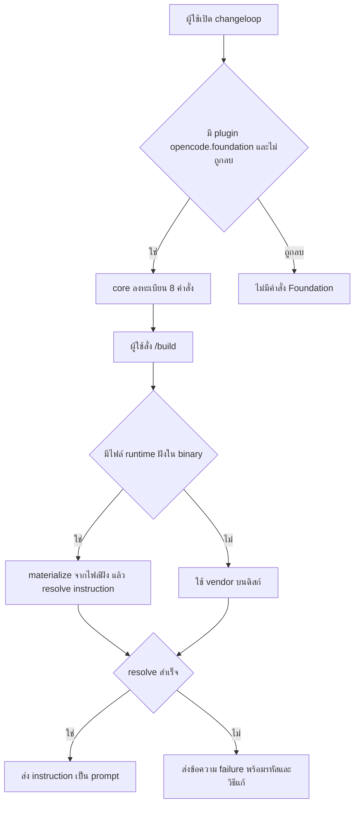

# Design

## Work type

feature

## เส้นทางผู้ใช้

ผู้ใช้เปิด changeloop แล้วเรียกคำสั่ง Foundation ได้ทันทีโดยไม่ต้องติดตั้ง runtime แยก



## ตารางความล้มเหลว

| Failure | User sees | Recovery |
|---|---|---|
| ไม่มีโมดูล embedded (รันจาก source หรือ test) | คำสั่ง Foundation ทำงานตามปกติจาก vendor บนดิสก์ | ไม่ต้องทำอะไร |
| vendor payload ไม่ตรง manifest ตอน build | build หยุดพร้อมข้อความ checksum mismatch | sync vendor ใหม่ด้วย foundation:sync แล้ว build ซ้ำ |
| ไฟล์ฝังเสียหายตอนรัน | คำสั่งตอบข้อความ foundation_bundle_invalid ให้ติดตั้ง release ใหม่ | ติดตั้ง changeloop release ใหม่ |
| ผู้ใช้ไม่ต้องการ workflow | ไม่มีคำสั่ง Foundation ใน list | ลบ plugin opencode.foundation ใน config plugin |

## แผนที่ไฟล์

| Tasks | Paths |
|---|---|
| T001 | `packages/foundation/src/plugin.ts`, `packages/foundation/src/virtual.d.ts` (add), `packages/foundation/test/plugin.test.ts` |
| T002 | `packages/core/package.json`, `packages/core/src/plugin/internal.ts`, `packages/core/test/plugin/foundation-builtin.test.ts` (add) |
| T002; T003 | `bun.lock` |
| T003 | `packages/cli/script/foundation-files.ts` (add), `packages/cli/script/foundation-files.test.ts` (add), `packages/cli/script/build.ts`, `packages/cli/package.json` |

`+` add · `~` change · `-` remove

```text
.
├── ~ bun.lock
└── packages/
    ├── cli/
    │   ├── ~ package.json
    │   └── script/
    │       ├── ~ build.ts
    │       ├── + foundation-files.test.ts
    │       └── + foundation-files.ts
    ├── core/
    │   ├── ~ package.json
    │   ├── src/
    │   │   └── plugin/
    │   │       └── ~ internal.ts
    │   └── test/
    │       └── plugin/
    │           └── + foundation-builtin.test.ts
    └── foundation/
        ├── src/
        │   ├── ~ plugin.ts
        │   └── + virtual.d.ts
        └── test/
            └── ~ plugin.test.ts
```

## แผนที่ test

| Scenario | Level | Check | Task |
|---|---|---|---|
| มีไฟล์ฝัง; ไม่มีโมดูล; ผู้เรียกกำหนด files เอง | task check | `o=$(bun test --cwd packages/foundation test/plugin.test.ts 2>&1); r=$?; echo "$o"; p=$(echo "$o" \| sed -n 's/^ *\([0-9]*\) pass$/\1/p'); f=$(echo "$o" \| sed -n 's/^ *\([0-9]*\) fail$/\1/p'); echo "Tests: ${f:-0} failed, ${p:-0} passed, $((${p:-0}+${f:-0})) total"; exit $r` | T001 |
| ลงทะเบียน builtin; ลำดับก่อน config command; ผู้ใช้ปิด | task check | `o=$(bun test --cwd packages/core test/plugin/foundation-builtin.test.ts 2>&1); r=$?; echo "$o"; p=$(echo "$o" \| sed -n 's/^ *\([0-9]*\) pass$/\1/p'); f=$(echo "$o" \| sed -n 's/^ *\([0-9]*\) fail$/\1/p'); echo "Tests: ${f:-0} failed, ${p:-0} passed, $((${p:-0}+${f:-0})) total"; exit $r` | T002 |
| โมดูลที่สร้างอ่านได้; vendor เสีย; binary จริง | task check | `o=$(bun test --cwd packages/cli script/foundation-files.test.ts 2>&1); r=$?; echo "$o"; p=$(echo "$o" \| sed -n 's/^ *\([0-9]*\) pass$/\1/p'); f=$(echo "$o" \| sed -n 's/^ *\([0-9]*\) fail$/\1/p'); echo "Tests: ${f:-0} failed, ${p:-0} passed, $((${p:-0}+${f:-0})) total"; exit $r` | T003 |
