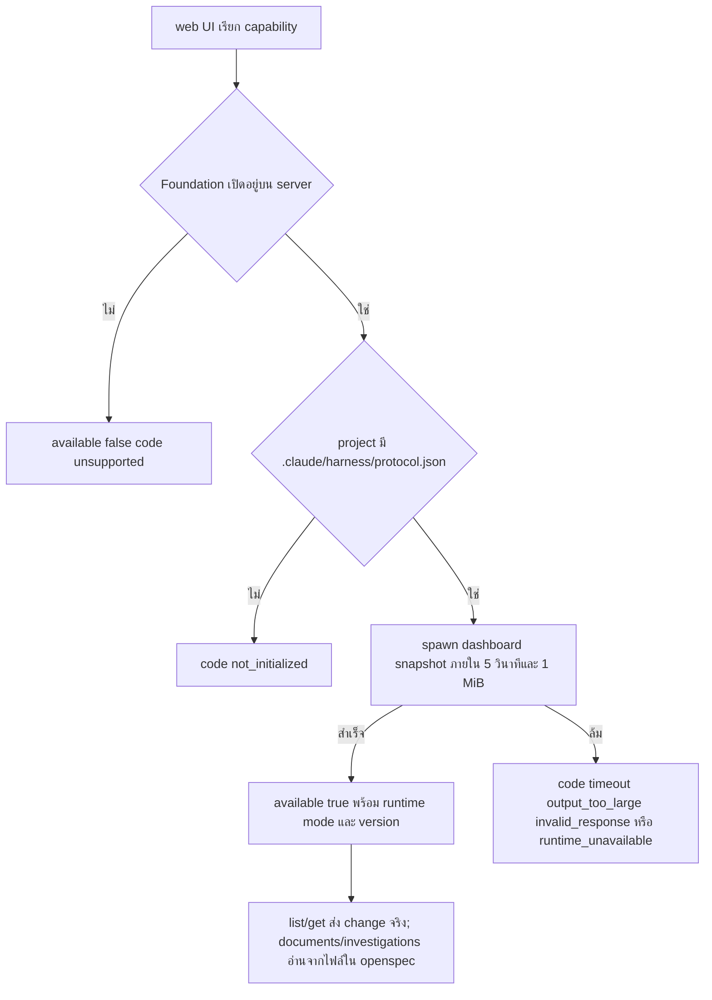

# Design

## Work type

feature, api

## สถาปัตยกรรม

| ขอบเขต | รูปแบบ | เหตุผล | Timeout/การลองใหม่ | ความสอดคล้อง | เจ้าของ |
|---|---|---|---|---|---|
| server handler → claude-foundation dashboard snapshot (process ลูก) | sync | อ่านสถานะ change ของ project ตอนรับ request | 5s แล้วฆ่า process group; ลองใหม่: none; read ถัดไปลองใหม่ | strong | foundation-runtime |
| server handler → ระบบไฟล์ของ project (openspec/**) | sync | ทำดัชนีและอ่านเอกสารของ change และ investigation | 5s ต่อ request และไม่เกิน 4096 รายการที่สแกน; ลองใหม่: retry ภายในหนึ่งครั้งเมื่อไฟล์เปลี่ยนระหว่างอ่าน | strong | foundation-documents |

## เส้นทางผู้ใช้

ผู้ใช้เปิด web UI ของ changeloop ใน project ที่มี Foundation แล้วเห็นรายการ change เอกสาร และ investigation จริง



## สัญญา API

### GET /experimental/foundation/capability

| ส่วน | สัญญา |
|---|---|
| การยืนยันสิทธิ์ | เหมือน route อื่นของ server (authorization middleware) |
| Request | location: directory ทางเลือก |
| Response | available: boolean, code: string\|null, runtime: {mode,version}\|null |

### GET /experimental/foundation/changes

| ส่วน | สัญญา |
|---|---|
| การยืนยันสิทธิ์ | เหมือน route อื่นของ server (authorization middleware) |
| Request | scope: active\|archive, search: string, offset: string, limit: string |
| Response | generatedAt: string, items: Change[], total: number, nextOffset: number\|null, diagnostics: string[] |

**Error:**

| Status | Code | เมื่อ | ลองใหม่ได้ |
|---|---|---|---|
| 400 | — | offset, limit, scope หรือ search ไม่ถูกต้อง | — |
| 409 | — | project ยังไม่ init Foundation (not_initialized) | — |
| 502 | — | snapshot เกิน 1 MiB หรือผิดรูป (output_too_large, invalid_response) | — |
| 503 | — | runtime ใช้ไม่ได้หรือ server ปิด Foundation (runtime_unavailable, unsupported) | — |
| 504 | — | runtime ไม่ตอบภายใน 5 วินาที (timeout) | — |

### GET /experimental/foundation/changes/:changeID

| ส่วน | สัญญา |
|---|---|
| การยืนยันสิทธิ์ | เหมือน route อื่นของ server (authorization middleware) |
| Request | changeID: string |
| Response | id: string, status: string, phase: string |

**Error:**

| Status | Code | เมื่อ | ลองใหม่ได้ |
|---|---|---|---|
| 400 | — | changeID ผิดรูปแบบ | — |
| 404 | — | ไม่พบ change | — |
| 409 | — | project ยังไม่ init Foundation | — |

### GET /experimental/foundation/changes/:changeID/documents

| ส่วน | สัญญา |
|---|---|
| การยืนยันสิทธิ์ | เหมือน route อื่นของ server (authorization middleware) |
| Request | changeID: string, search: string, offset: string, limit: string |
| Response | items: DocumentMetadata[], total: number, nextOffset: number\|null, readAt: string, diagnostics: string[] |

**Error:**

| Status | Code | เมื่อ | ลองใหม่ได้ |
|---|---|---|---|
| 400 | — | changeID หรือ query ไม่ถูกต้อง | — |
| 404 | — | ไม่พบเอกสารของ change | — |

### GET /experimental/foundation/changes/:changeID/documents/:documentID

| ส่วน | สัญญา |
|---|---|
| การยืนยันสิทธิ์ | เหมือน route อื่นของ server (authorization middleware) |
| Request | changeID: string, documentID: sha256 hex 64 ตัว |
| Response | id: string, text: string, sha256: string, sections: Section[], tasks: Task[], references: Reference[] |

**Error:**

| Status | Code | เมื่อ | ลองใหม่ได้ |
|---|---|---|---|
| 400 | — | documentID ผิดรูปหรือเอกสารเป็น symlink | — |
| 404 | — | ไม่พบเอกสาร | — |
| 413 | — | เอกสารเกิน 256 KiB | — |

### GET /experimental/foundation/investigations

| ส่วน | สัญญา |
|---|---|
| การยืนยันสิทธิ์ | เหมือน route อื่นของ server (authorization middleware) |
| Request | search: string, offset: string, limit: string |
| Response | items: DocumentMetadata[], total: number, nextOffset: number\|null, readAt: string, diagnostics: string[] |

**Error:**

| Status | Code | เมื่อ | ลองใหม่ได้ |
|---|---|---|---|
| 400 | — | query ไม่ถูกต้อง | — |

### GET /experimental/foundation/investigations/:investigationID

| ส่วน | สัญญา |
|---|---|
| การยืนยันสิทธิ์ | เหมือน route อื่นของ server (authorization middleware) |
| Request | investigationID: sha256 hex 64 ตัว |
| Response | id: string, text: string, sha256: string, sections: Section[], references: Reference[] |

**Error:**

| Status | Code | เมื่อ | ลองใหม่ได้ |
|---|---|---|---|
| 400 | — | investigationID ผิดรูป | — |
| 404 | — | ไม่พบ investigation | — |

## ตารางความล้มเหลว

| Failure | User sees | Recovery |
|---|---|---|
| project ยังไม่ init Foundation | list/get ตอบ 409 not_initialized ส่วน capability ตอบ available false พร้อม code; investigations ยังอ่านได้ | รัน changeloop foundation init แล้วโหลดใหม่ |
| runtime ไม่ตอบภายใน 5 วินาที | ตอบ timeout และ process ลูกถูกฆ่า | ลองใหม่; read ถัดไปไม่ใช้ผลที่ล้มซ้ำ |
| runtime พิมพ์เกิน 1 MiB หรือ JSON ผิดรูป | ตอบ output_too_large หรือ invalid_response | ตรวจ/ติดตั้ง runtime ใหม่ |
| input ไม่ถูกต้อง (limit นอก 1..100, scope แปลก, id ผิดรูป) | ตอบ 400 invalid_input ก่อน spawn runtime | แก้ query |
| server ปิด Foundation (workerd หรือ foundation.enabled=false) | ตอบ unsupported ทุก endpoint ที่ต้องใช้ service | ไม่ต้องทำอะไร ฟีเจอร์ไม่รองรับบน host นี้ |

## แผนที่ไฟล์

| Tasks | Paths |
|---|---|
| T001 | `packages/foundation/src/foundation-webui.ts` (add), `packages/foundation/src/embedded-files.ts` (add), `packages/foundation/src/plugin.ts`, `packages/foundation/test/foundation-webui.test.ts` (add) |
| T002 | `packages/core/src/foundation-document-reader.ts` (add), `packages/core/test/foundation-document-reader.test.ts` (add) |
| T003 | `packages/core/src/foundation-live.ts` (add), `packages/server/src/routes.ts`, `packages/server/src/options.ts`, `packages/server/src/workerd.ts`, `packages/server/test/foundation.test.ts` |

`+` add · `~` change · `-` remove

```text
.
└── packages/
    ├── core/
    │   ├── src/
    │   │   ├── + foundation-document-reader.ts
    │   │   └── + foundation-live.ts
    │   └── test/
    │       └── + foundation-document-reader.test.ts
    ├── foundation/
    │   ├── src/
    │   │   ├── + embedded-files.ts
    │   │   ├── + foundation-webui.ts
    │   │   └── ~ plugin.ts
    │   └── test/
    │       └── + foundation-webui.test.ts
    └── server/
        ├── src/
        │   ├── ~ options.ts
        │   ├── ~ routes.ts
        │   └── ~ workerd.ts
        └── test/
            └── ~ foundation.test.ts
```

## แผนที่ test

| Scenario | Level | Check | Task |
|---|---|---|---|
| project ยังไม่ init; runtime path หาไม่พบ; snapshot สำเร็จ; schema ไม่รองรับ ผิดรูป หรือ exit ไม่ใช่ศูนย์; เกินขีดจำกัด; อ่านซ้อน; bundled จากไฟล์ที่ฝัง | task check | `o=$(bun test --cwd packages/foundation test/foundation-webui.test.ts test/plugin.test.ts 2>&1); r=$?; echo "$o"; p=$(echo "$o" \| sed -n 's/^ *\([0-9]*\) pass$/\1/p'); f=$(echo "$o" \| sed -n 's/^ *\([0-9]*\) fail$/\1/p'); echo "Tests: ${f:-0} failed, ${p:-0} passed, $((${p:-0}+${f:-0})) total"; exit $r` | T001 |
| investigation ก่อน init; เอกสารของ change; archive; ป้องกันการออกนอก project; เอกสารใหญ่เกินและไม่พบ; references | task check | `o=$(bun test --cwd packages/core test/foundation-document-reader.test.ts 2>&1); r=$?; echo "$o"; p=$(echo "$o" \| sed -n 's/^ *\([0-9]*\) pass$/\1/p'); f=$(echo "$o" \| sed -n 's/^ *\([0-9]*\) fail$/\1/p'); echo "Tests: ${f:-0} failed, ${p:-0} passed, $((${p:-0}+${f:-0})) total"; exit $r` | T002 |
| ข้อมูลจริง; change ไม่มี; ไม่ได้ init; input ไม่ถูกต้อง; runtime ค้าง; runtime พิมพ์เกิน; เอกสารผ่าน HTTP; id เอกสารผิดรูปหรือไม่พบ; ปิด Foundation | task check | `o=$(bun test --cwd packages/server test/foundation.test.ts test/options.test.ts test/workerd.test.ts 2>&1); r=$?; echo "$o"; p=$(echo "$o" \| sed -n 's/^ *\([0-9]*\) pass$/\1/p'); f=$(echo "$o" \| sed -n 's/^ *\([0-9]*\) fail$/\1/p'); echo "Tests: ${f:-0} failed, ${p:-0} passed, $((${p:-0}+${f:-0})) total"; exit $r` | T003 |
