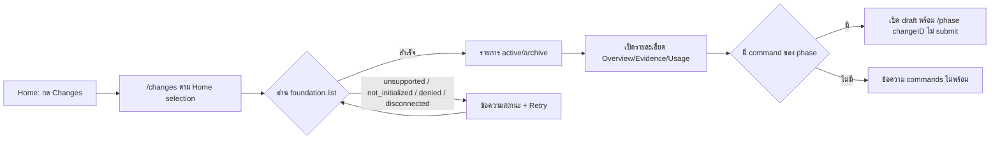

# Design

## Work type

ui

## เส้นทางผู้ใช้

ผู้ใช้เปิด Changes จาก Home เลือกโปรเจกต์ ดูรายการ เปิดรายละเอียด และเปิด draft ต่อใน session รวมถึงเส้นทางที่ server ไม่รองรับหรือล้มเหลว



## โมเดลโดเมนและโมดูล

| Component | Responsibility | Files | Tasks |
|---|---|---|---|
| Changes route | ประกอบ HomeProjects, reader, refresh controller และ view ตาม Home selection และ query | packages/app/src/changes/route.tsx | T003 |
| Changes view | รายการ, สถานะ failure, รายละเอียด และ workflow track | packages/app/src/changes/view.tsx | T002 |
| Foundation reader | เรียก foundation.list/get ผ่าน client, decode ด้วย schema และแปลง error เป็น code | packages/app/src/changes/reader.ts | T001 |
| Refresh controller | key ตาม server+directory, ทิ้ง response ที่มาช้า, poll ทุก 10 วินาทีเมื่อมองเห็น และคงข้อมูลเดิมเมื่อ refresh ล้ม | packages/app/src/changes/refresh.ts | T001 |
| Draft handoff | เลือกคำสั่งตาม phase จาก command ที่มีจริง | packages/app/src/changes/draft.ts | T001 |
| Routing and entry | ลงทะเบียน /changes, LayoutRoute changes และปุ่มทางเข้าใน Home projects | packages/app/src/shell/routes/routes.tsx, packages/app/src/shell/state/layout.tsx, packages/app/src/shell/titlebar/titlebar.tsx, packages/app/src/home/projects/view.tsx, packages/app/src/home/projects/region.tsx, packages/app/src/home/projects/controller.tsx, packages/app/src/runtime/i18n/en.ts | T003, T002 |

## สัญญา UI

### Changes list

| State | Shows | Actions |
|---|---|---|
| loading | Loading changes แบบ role=status ก่อนมีข้อมูล และ Refreshing เมื่อมีข้อมูลเดิม | — |
| empty | No active changes / No archived changes / No changes match your search แยกกัน | — |
| unsupported | ข้อความว่า server หรือ runtime ไม่รองรับ Changes พร้อม Retry และไม่ถือเป็นรายการว่าง | — |
| not-initialized | ข้อความว่า Foundation ยังไม่ถูก init ในโปรเจกต์นี้ พร้อม Retry และไม่ init ให้เอง | — |
| error | denied, timeout, invalid_response, disconnected แต่ละอย่างมีข้อความของตัวเอง พร้อม Retry | — |
| stale | คงข้อมูลสำเร็จครั้งล่าสุดพร้อม generatedAt และข้อความ Showing stale data | — |
| success | แถว change: ชื่อหรือ ID, Phase, Status, Evidence, ท้ายหน้ามี Snapshot generatedAt และ pagination | — |

- **Accessibility:** ปุ่มเลือกแถวเป็น button ในรายการ aria-label, search มี aria-label, หมวด active/archive ใช้ aria-pressed, สถานะแสดงเป็นข้อความไม่พึ่งสี

### Change detail

| State | Shows | Actions |
|---|---|---|
| overview | ID, title, status, updated, workflow track ตาม phase และปุ่ม Continue in session | — |
| evidence | recordedStatus, status ปัจจุบัน และ freshness แยกกัน พร้อมรายการ providers | — |
| usage | budget และ run branch/operationMs โดยค่า null แสดง Unavailable ไม่ใช่ 0 | — |
| draft-error | ข้อความ Foundation commands ไม่พร้อม หรือโหลด commands ไม่ได้ โดย session ปกติยังใช้ได้ | — |

- **Accessibility:** แท็บรายละเอียดใช้ nav aria-label ลูกศรซ้ายขวาย้าย focus, aria-current บนแท็บปัจจุบัน

## ตารางความล้มเหลว

| Failure | User sees | Recovery | Covers |
|---|---|---|---|
| ไม่มี evidence | แถวแสดง Evidence เป็น Unavailable ไม่ใช่ค่าว่างหรือ pass | No separate step; the outcome is the handling | changes-list |
| ว่างแยกตามเงื่อนไข | แสดงข้อความ No active changes, No archived changes และ No changes match your search ตามลำดับ | No separate step; the outcome is the handling | changes-list |
| server ไม่รองรับ | reader ล้มด้วย code unsupported และ view แสดงข้อความว่าไม่รองรับ Changes พร้อม Retry ไม่แสดง No active changes | กด Retry หลัง server รองรับ | failure-states |
| ยังไม่ init | view แสดงว่า Foundation ยังไม่ถูก init ในโปรเจกต์นี้ และไม่ส่ง request ที่เขียนหรือ init ใด ๆ | ผู้ใช้ init โปรเจกต์ด้วยตนเองแล้วกด Retry | failure-states |
| ไม่มีสิทธิ์หรือ transport ล้ม | reader คืน code denied และ disconnected ตามลำดับ และ view แสดงข้อความของแต่ละ code | No separate step; the outcome is the handling | failure-states |
| response ผิด schema | reader ล้มด้วย code invalid_response และไม่ส่งข้อมูลบางส่วนให้ view | No separate step; the outcome is the handling | failure-states |
| คงข้อมูลเดิม | view ยังแสดงรายการเดิมพร้อม generatedAt เดิมและข้อความ Showing stale data from the last successful read | No separate step; the outcome is the handling | failure-states |
| usage เป็น null | แท็บ Usage แสดง Unavailable ในช่องนั้น ไม่แสดง 0 | No separate step; the outcome is the handling | change-detail |
| ไม่มี budget | แท็บ Usage แสดงว่า Usage is unavailable | No separate step; the outcome is the handling | change-detail |
| ข้อมูลเดิมเมื่อล้ม | state เก็บข้อมูลเดิมไว้ ตั้ง stale เป็น true และตั้ง error เป็น code ของความล้มเหลว | No separate step; the outcome is the handling | selection-refresh |
| ไม่มีคำสั่ง | changeDraft คืน undefined และ view แสดงข้อความ Foundation commands ไม่พร้อมโดยไม่เปิด draft | No separate step; the outcome is the handling | session-draft-handoff |
| โหลด commands ไม่ได้ | view แสดงข้อความ Unable to load project commands และไม่เปิด draft | ผู้ใช้กดใหม่เมื่อ server พร้อม | session-draft-handoff |
| ไม่มีโปรเจกต์ | หน้า Changes แสดงข้อความให้เลือกโปรเจกต์และไม่ส่ง request | No separate step; the outcome is the handling | route-and-entry |

## แผนที่ไฟล์

| Tasks | Paths |
|---|---|
| T001 | `packages/app/src/changes/reader.ts` (add), `packages/app/src/changes/reader.test.ts` (add), `packages/app/src/changes/refresh.ts` (add), `packages/app/src/changes/refresh.test.ts` (add), `packages/app/src/changes/draft.ts` (add), `packages/app/src/changes/draft.test.ts` (add) |
| T002 | `packages/app/src/changes/view.tsx` (add), `packages/app/src/changes/view.test.tsx` (add), `packages/app/src/runtime/i18n/en.ts` |
| T003 | `packages/app/src/changes/route.tsx` (add), `packages/app/src/shell/routes/routes.tsx`, `packages/app/src/shell/state/layout.tsx`, `packages/app/src/shell/state/layout.test.ts`, `packages/app/src/shell/titlebar/titlebar.tsx`, `packages/app/src/home/projects/view.tsx`, `packages/app/src/home/projects/region.tsx`, `packages/app/src/home/projects/controller.tsx` |

`+` add · `~` change · `-` remove

```text
.
└── packages/
    └── app/
        └── src/
            ├── changes/
            │   ├── + draft.test.ts
            │   ├── + draft.ts
            │   ├── + reader.test.ts
            │   ├── + reader.ts
            │   ├── + refresh.test.ts
            │   ├── + refresh.ts
            │   ├── + route.tsx
            │   ├── + view.test.tsx
            │   └── + view.tsx
            ├── home/
            │   └── projects/
            │       ├── ~ controller.tsx
            │       ├── ~ region.tsx
            │       └── ~ view.tsx
            ├── runtime/
            │   └── i18n/
            │       └── ~ en.ts
            └── shell/
                ├── routes/
                │   └── ~ routes.tsx
                ├── state/
                │   ├── ~ layout.test.ts
                │   └── ~ layout.tsx
                └── titlebar/
                    └── ~ titlebar.tsx
```

## แผนที่ test

| Scenario | Level | Check | Task |
|---|---|---|---|
| server ไม่รองรับ; ยังไม่ init; ไม่มีสิทธิ์หรือ transport ล้ม; response ผิด schema; คงข้อมูลเดิม; ทิ้ง response เก่า; poll เมื่อมองเห็น; รวม request; ข้อมูลเดิมเมื่อล้ม; เลือกคำสั่งตาม phase; archived ใช้ /changes; ไม่มีคำสั่ง; โหลด commands ไม่ได้ | task check | `o=$(bun test --cwd packages/app --conditions=solid --isolate --preload ../ui/test/solid-jsx.ts --preload ./happydom.ts ./src/changes/reader.test.ts ./src/changes/refresh.test.ts ./src/changes/draft.test.ts 2>&1); r=$?; echo "$o"; p=$(echo "$o" \| sed -n 's/^ *\([0-9]*\) pass$/\1/p'); f=$(echo "$o" \| sed -n 's/^ *\([0-9]*\) fail$/\1/p'); echo "Tests: ${f:-0} failed, ${p:-0} passed, $((${p:-0}+${f:-0})) total"; exit $r` | T001 |
| แสดงรายการ; ไม่มี evidence; archived เป็นประวัติ; ว่างแยกตามเงื่อนไข; pagination; server ไม่รองรับ; ยังไม่ init; ไม่มีสิทธิ์หรือ transport ล้ม; response ผิด schema; คงข้อมูลเดิม; evidence แยกสามค่า; usage เป็น null; ไม่มี budget; workflow track; เลื่อนแท็บด้วยคีย์บอร์ด | task check | `o=$(bun test --cwd packages/app --conditions=solid --isolate --preload ../ui/test/solid-jsx.ts --preload ./happydom.ts ./src/changes/view.test.tsx 2>&1); r=$?; echo "$o"; p=$(echo "$o" \| sed -n 's/^ *\([0-9]*\) pass$/\1/p'); f=$(echo "$o" \| sed -n 's/^ *\([0-9]*\) fail$/\1/p'); echo "Tests: ${f:-0} failed, ${p:-0} passed, $((${p:-0}+${f:-0})) total"; exit $r` | T002 |
| จำแนก route; ไม่มีโปรเจกต์; typecheck ทั้ง app; เลือกคำสั่งตาม phase; archived ใช้ /changes; ไม่มีคำสั่ง; โหลด commands ไม่ได้ | task check | `o=$(bun test --cwd packages/app --conditions=solid --isolate --preload ../ui/test/solid-jsx.ts --preload ./happydom.ts ./src/shell/state/layout.test.ts 2>&1); r=$?; echo "$o"; p=$(echo "$o" \| sed -n 's/^ *\([0-9]*\) pass$/\1/p'); f=$(echo "$o" \| sed -n 's/^ *\([0-9]*\) fail$/\1/p'); echo "Tests: ${f:-0} failed, ${p:-0} passed, $((${p:-0}+${f:-0})) total"; [ $r -eq 0 ] \|\| exit $r; bun run --cwd packages/app typecheck` | T003 |
