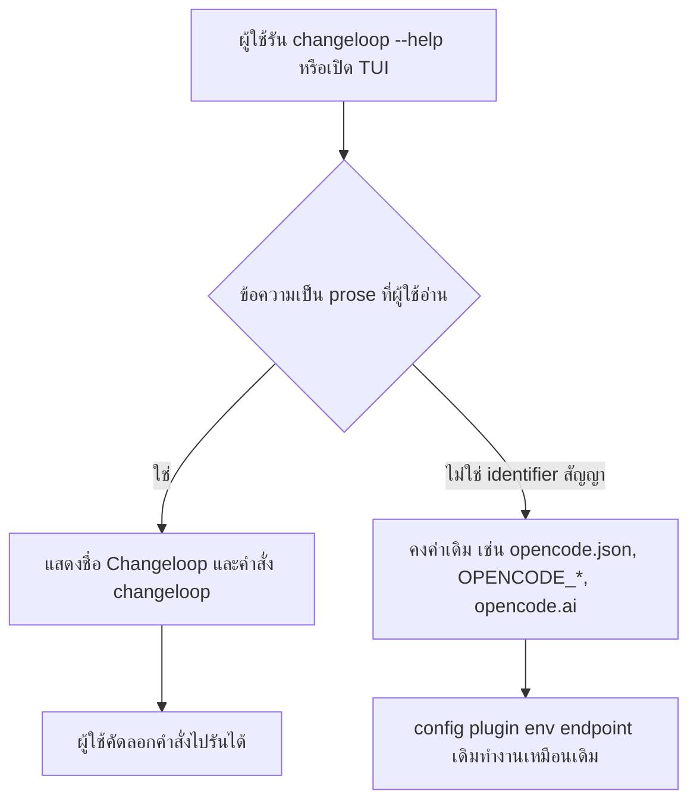

# Design

## Work type

feature

## เส้นทางผู้ใช้

ผู้ใช้ที่ดู help หรืออ่านข้อความในโปรแกรมเห็นชื่อ Changeloop และคัดลอกคำสั่งที่แนะนำไปรันได้จริง



## ตารางความล้มเหลว

| Failure | User sees | Recovery |
|---|---|---|
| ข้อความใหม่ถูกเพิ่มโดยมีคำว่า OpenCode ใน prose | guard test ล้มพร้อมระบุไฟล์และบรรทัด | เปลี่ยนเป็น Changeloop หรือเพิ่มเข้า allowlist พร้อมเหตุผล |
| เผลอเปลี่ยน identifier สัญญา (id/env/config/URL) | test regression ของ identifier ล้ม | คืนค่า identifier เดิม |
| จอแคบกว่าความกว้าง wordmark | wordmark แสดงแบบ stack สองส่วนไม่ถูกตัดแถว | ไม่ต้องทำอะไร |

## แผนที่ไฟล์

| Tasks | Paths |
|---|---|
| T001 | `packages/tui/src/logo.ts`, `packages/tui/src/component/logo.tsx`, `packages/tui/src/util/presentation.ts`, `packages/tui/test/util/presentation.test.ts`, `packages/tui/test/util/logo.test.ts` (add) |
| T002 | `packages/cli/src/commands/commands.ts`, `packages/cli/src/commands/handlers/pair.ts`, `packages/cli/src/commands/handlers/uninstall.ts`, `packages/cli/src/commands/handlers/upgrade.ts`, `packages/cli/src/commands/handlers/default.ts`, `packages/cli/src/commands/handlers/mcp/auth.ts`, `packages/cli/src/commands/handlers/acp.ts`, `packages/cli/src/commands/handlers/stats.ts`, `packages/cli/src/acp/error.ts`, `packages/cli/src/acp/translate.ts`, `packages/cli/src/acp/service.ts`, `packages/cli/src/services/updater.ts`, `packages/cli/src/services/update-preflight.tsx`, `packages/cli/src/services/remote-tunnel.ts`, `packages/cli/src/services/service-config.ts`, `packages/cli/src/server-process.ts`, `packages/cli/src/mini-host.ts`, `packages/cli/src/mini.ts`, `packages/cli/test/rebrand-help.test.ts` (add), `packages/cli/test/acp/error.test.ts`, `packages/cli/test/acp/session.test.ts`, `packages/cli/test/acp/lifecycle.subprocess.test.ts`, `packages/cli/test/pair-remote-consent.test.ts`, `packages/cli/test/stats.test.ts`, `packages/cli/test/mini.test.ts`, `packages/cli/test/service-lifecycle.test.ts` |
| T003 | `packages/tui/src/app.tsx`, `packages/tui/src/attention.ts`, `packages/tui/src/config/index.tsx`, `packages/tui/src/component/error-component.tsx`, `packages/tui/src/component/dialog-update.tsx`, `packages/tui/src/component/dialog-pair.tsx`, `packages/tui/src/component/terminal-pane.tsx`, `packages/tui/src/feature-plugins/sidebar/footer.tsx`, `packages/tui/src/feature-plugins/system/stats.tsx`, `packages/tui/src/mini/runtime.lifecycle.ts`, `packages/tui/src/mini/footer.permission.tsx`, `packages/tui/src/mini/footer.prompt.tsx`, `packages/tui/src/mini/splash.ts`, `packages/tui/src/routes/session/permission.tsx`, `packages/tui/src/util/error-details.ts`, `packages/tui/src/util/error.ts`, `packages/tui/test/brand-prose.test.ts` (add), `packages/tui/test/app-lifecycle.test.tsx`, `packages/tui/test/mini/splash.test.ts`, `packages/tui/test/component/dialog-update.test.tsx`, `packages/tui/test/cli/tui/dialog-mcp.test.tsx`, `packages/tui/test/mini/blocker.responsive.test.tsx`, `packages/tui/test/feature-plugins/sidebar-footer.test.tsx` |

`+` add · `~` change · `-` remove

```text
.
└── packages/
    ├── cli/
    │   ├── src/
    │   │   ├── acp/
    │   │   │   ├── ~ error.ts
    │   │   │   ├── ~ service.ts
    │   │   │   └── ~ translate.ts
    │   │   ├── commands/
    │   │   │   ├── ~ commands.ts
    │   │   │   └── handlers/
    │   │   │       ├── ~ acp.ts
    │   │   │       ├── ~ default.ts
    │   │   │       ├── mcp/
    │   │   │       │   └── ~ auth.ts
    │   │   │       ├── ~ pair.ts
    │   │   │       ├── ~ stats.ts
    │   │   │       ├── ~ uninstall.ts
    │   │   │       └── ~ upgrade.ts
    │   │   ├── ~ mini-host.ts
    │   │   ├── ~ mini.ts
    │   │   ├── ~ server-process.ts
    │   │   └── services/
    │   │       ├── ~ remote-tunnel.ts
    │   │       ├── ~ service-config.ts
    │   │       ├── ~ update-preflight.tsx
    │   │       └── ~ updater.ts
    │   └── test/
    │       ├── acp/
    │       │   ├── ~ error.test.ts
    │       │   ├── ~ lifecycle.subprocess.test.ts
    │       │   └── ~ session.test.ts
    │       ├── ~ mini.test.ts
    │       ├── ~ pair-remote-consent.test.ts
    │       ├── + rebrand-help.test.ts
    │       ├── ~ service-lifecycle.test.ts
    │       └── ~ stats.test.ts
    └── tui/
        ├── src/
        │   ├── ~ app.tsx
        │   ├── ~ attention.ts
        │   ├── component/
        │   │   ├── ~ dialog-pair.tsx
        │   │   ├── ~ dialog-update.tsx
        │   │   ├── ~ error-component.tsx
        │   │   ├── ~ logo.tsx
        │   │   └── ~ terminal-pane.tsx
        │   ├── config/
        │   │   └── ~ index.tsx
        │   ├── feature-plugins/
        │   │   ├── sidebar/
        │   │   │   └── ~ footer.tsx
        │   │   └── system/
        │   │       └── ~ stats.tsx
        │   ├── ~ logo.ts
        │   ├── mini/
        │   │   ├── ~ footer.permission.tsx
        │   │   ├── ~ footer.prompt.tsx
        │   │   ├── ~ runtime.lifecycle.ts
        │   │   └── ~ splash.ts
        │   ├── routes/
        │   │   └── session/
        │   │       └── ~ permission.tsx
        │   └── util/
        │       ├── ~ error-details.ts
        │       ├── ~ error.ts
        │       └── ~ presentation.ts
        └── test/
            ├── ~ app-lifecycle.test.tsx
            ├── + brand-prose.test.ts
            ├── cli/
            │   └── tui/
            │       └── ~ dialog-mcp.test.tsx
            ├── component/
            │   └── ~ dialog-update.test.tsx
            ├── feature-plugins/
            │   └── ~ sidebar-footer.test.tsx
            ├── mini/
            │   ├── ~ blocker.responsive.test.tsx
            │   └── ~ splash.test.ts
            └── util/
                ├── + logo.test.ts
                └── ~ presentation.test.ts
```

## แผนที่ test

| Scenario | Level | Check | Task |
|---|---|---|---|
| ตารางแถว; epilogue | task check | `o=$(bun test --cwd packages/tui test/util/presentation.test.ts test/util/logo.test.ts 2>&1); r=$?; echo "$o"; p=$(echo "$o" \| sed -n 's/^ *\([0-9]*\) pass$/\1/p'); f=$(echo "$o" \| sed -n 's/^ *\([0-9]*\) fail$/\1/p'); echo "Tests: ${f:-0} failed, ${p:-0} passed, $((${p:-0}+${f:-0})) total"; exit $r` | T001 |
| root help; subcommand help; คำสั่งแนะนำ; acp; ชื่อบริการคงเดิม | task check | `o=$(bun test --cwd packages/cli --timeout 60000 test/rebrand-help.test.ts test/acp/error.test.ts test/acp/session.test.ts test/acp/lifecycle.subprocess.test.ts test/pair-remote-consent.test.ts test/stats.test.ts test/mini.test.ts test/service-lifecycle.test.ts test/upgrade.test.ts test/updater-install.test.ts 2>&1); r=$?; echo "$o"; p=$(echo "$o" \| sed -n 's/^ *\([0-9]*\) pass$/\1/p'); f=$(echo "$o" \| sed -n 's/^ *\([0-9]*\) fail$/\1/p'); echo "Tests: ${f:-0} failed, ${p:-0} passed, $((${p:-0}+${f:-0})) total"; exit $r` | T002 |
| ชื่อหน้าต่างและ dialog; epilogue; guard ไม่พบ prose; identifier คงเดิม | task check | `o=$(bun test --cwd packages/tui --timeout 60000 test/app-lifecycle.test.tsx test/mini/splash.test.ts test/component/dialog-update.test.tsx test/cli/tui/dialog-mcp.test.tsx test/mini/blocker.responsive.test.tsx test/feature-plugins/sidebar-footer.test.tsx test/brand-prose.test.ts 2>&1); r=$?; echo "$o"; p=$(echo "$o" \| sed -n 's/^ *\([0-9]*\) pass$/\1/p'); f=$(echo "$o" \| sed -n 's/^ *\([0-9]*\) fail$/\1/p'); echo "Tests: ${f:-0} failed, ${p:-0} passed, $((${p:-0}+${f:-0})) total"; exit $r` | T003 |
