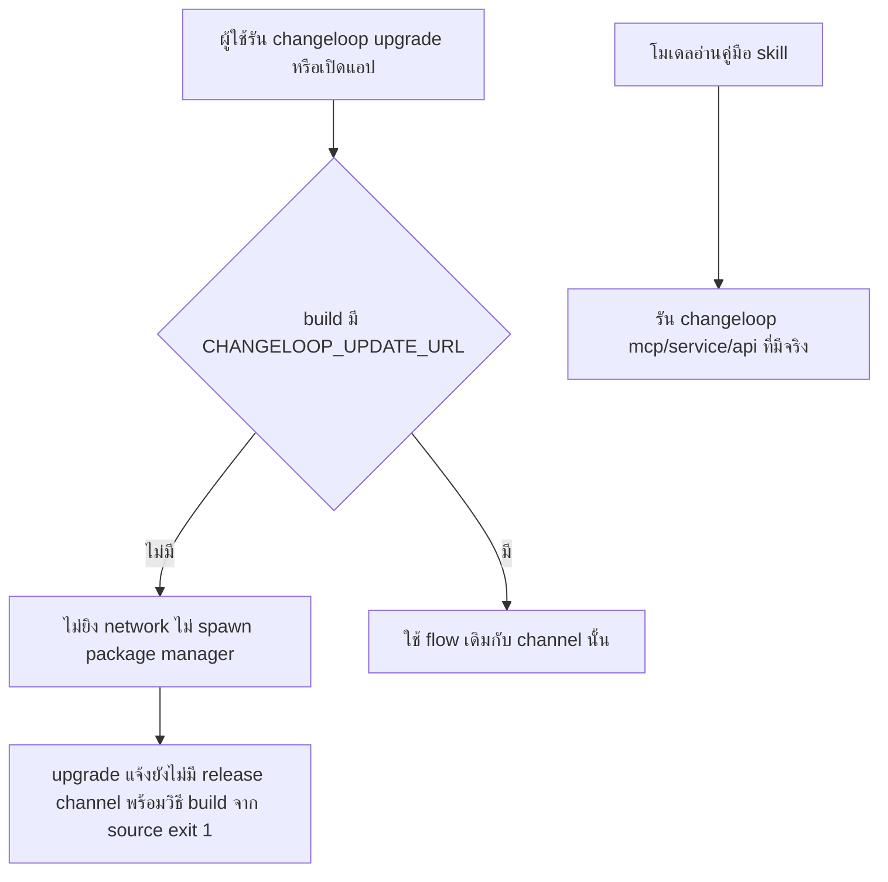

# Design

## Work type

bugfix, integration

## เส้นทางผู้ใช้

ผู้ใช้ที่รัน changeloop upgrade หรือเปิดแอปไม่ถูกพาไปติดตั้ง OpenCode ของ upstream ทับ และได้รู้วิธีอัปเดตที่ถูกต้อง ส่วนโมเดลเรียกคำสั่ง changeloop ที่มีอยู่จริง



## สัญญาการเชื่อมต่อระบบภายนอก

| ระบบภายนอก | ประเภท | เอกสาร | เวอร์ชัน | ข้อกังวล |
|---|---|---|---|---|
| upstream-update-service | external-api | packages/cli/src/services/updater.ts | v2-port 5097218e5b | authentication, timeout, retry, idempotency |

## Bugfix analysis

| ส่วน | รายละเอียด |
|---|---|
| วิธีทำให้เกิดซ้ำ | รัน changeloop upgrade หรือเปิดแอปใน build ที่ไม่มี release channel ของ Changeloop: updater ถาม opencode.ai/update/api แล้วติดตั้ง OpenCode ของ upstream ทับ binary ผู้ใช้ |
| สาเหตุที่แท้จริง | updater ฝัง URL และตัวระบุ package ของ upstream ไว้ตรงๆ โดยไม่มีค่าที่บอกว่า build นี้มี release channel หรือไม่ จึงเช็กและติดตั้งจาก upstream เสมอ |
| หลักฐาน regression | test updater ไม่มี channel ที่ fetch และ spawn ล้มถ้าถูกเรียก, test handler upgrade exit 1 พร้อมข้อความ, smoke binary จริงที่ proxy ชี้พอร์ตเสีย |

## ตารางความล้มเหลว

| Failure | User sees | Recovery |
|---|---|---|
| ผู้ใช้รัน changeloop upgrade ใน build ที่ไม่มี channel | ข้อความ ยังไม่มี release channel ของ Changeloop พร้อมวิธี build จาก source และ exit code 1 | build จาก source แล้วติดตั้งทับ binary ตามขั้นตอน Delivery |
| เปิดแอปโดยไม่มี channel | ไม่มีการแจ้งเตือนอัปเดตและไม่มี request ไป opencode.ai | ไม่ต้องทำอะไร |
| changeloop uninstall ใน build ที่ไม่มี channel | ลบเฉพาะ cache และแจ้งว่าไม่ได้ตรวจวิธีติดตั้ง ให้ลบ binary เอง | ลบ binary ด้วยตนเองตามข้อความ |
| มีคำสั่ง `opencode {subcommand}` ใหม่ในคู่มือที่ส่งให้โมเดล | test สแกนล้มพร้อมระบุไฟล์และบรรทัด | เปลี่ยนเป็น changeloop หรือเพิ่ม allowlist พร้อมเหตุผล |

## แผนที่ไฟล์

| Tasks | Paths |
|---|---|
| T001 | `packages/cli/src/services/updater.ts`, `packages/cli/src/version.ts`, `packages/cli/script/build.ts`, `packages/cli/test/updater-no-channel.test.ts` (add), `packages/cli/test/updater-install.test.ts` |
| T002 | `packages/cli/src/commands/handlers/upgrade.ts`, `packages/cli/test/fixture/upgrade.ts`, `packages/cli/test/upgrade.test.ts` |
| T003 | `packages/core/src/plugin/skill/opencode.md`, `packages/core/src/plugin/skill/report.md`, `packages/core/test/model-facing-commands.test.ts` (add) |

`+` add · `~` change · `-` remove

```text
.
└── packages/
    ├── cli/
    │   ├── script/
    │   │   └── ~ build.ts
    │   ├── src/
    │   │   ├── commands/
    │   │   │   └── handlers/
    │   │   │       └── ~ upgrade.ts
    │   │   ├── services/
    │   │   │   └── ~ updater.ts
    │   │   └── ~ version.ts
    │   └── test/
    │       ├── fixture/
    │       │   └── ~ upgrade.ts
    │       ├── ~ updater-install.test.ts
    │       ├── + updater-no-channel.test.ts
    │       └── ~ upgrade.test.ts
    └── core/
        ├── src/
        │   └── plugin/
        │       └── skill/
        │           ├── ~ opencode.md
        │           └── ~ report.md
        └── test/
            └── + model-facing-commands.test.ts
```

## แผนที่ test

| Scenario | Level | Check | Task |
|---|---|---|---|
| ตรวจตอนเปิดแอป; apply/latest/upgrade; ตรวจวิธีติดตั้ง; ใส่ channel ภายหลัง | task check | `o=$(bun test --cwd packages/cli test/updater-no-channel.test.ts test/updater-install.test.ts src/services/updater.test.ts 2>&1); r=$?; echo "$o"; p=$(echo "$o" \| sed -n 's/^ *\([0-9]*\) pass$/\1/p'); f=$(echo "$o" \| sed -n 's/^ *\([0-9]*\) fail$/\1/p'); echo "Tests: ${f:-0} failed, ${p:-0} passed, $((${p:-0}+${f:-0})) total"; exit $r` | T001 |
| ไม่ระบุ method; ระบุ method และ target; binary จริง | task check | `o=$(bun test --cwd packages/cli test/upgrade.test.ts 2>&1); r=$?; echo "$o"; p=$(echo "$o" \| sed -n 's/^ *\([0-9]*\) pass$/\1/p'); f=$(echo "$o" \| sed -n 's/^ *\([0-9]*\) fail$/\1/p'); echo "Tests: ${f:-0} failed, ${p:-0} passed, $((${p:-0}+${f:-0})) total"; exit $r` | T002 |
| คำสั่งใน skill; บรรทัดตัวตนคงเดิม; path และ env คงเดิม | task check | `o=$(bun test --cwd packages/core test/model-facing-commands.test.ts test/session-skill.test.ts test/session-system-prompt.test.ts test/skill.test.ts 2>&1); r=$?; echo "$o"; p=$(echo "$o" \| sed -n 's/^ *\([0-9]*\) pass$/\1/p'); f=$(echo "$o" \| sed -n 's/^ *\([0-9]*\) fail$/\1/p'); echo "Tests: ${f:-0} failed, ${p:-0} passed, $((${p:-0}+${f:-0})) total"; exit $r` | T003 |
