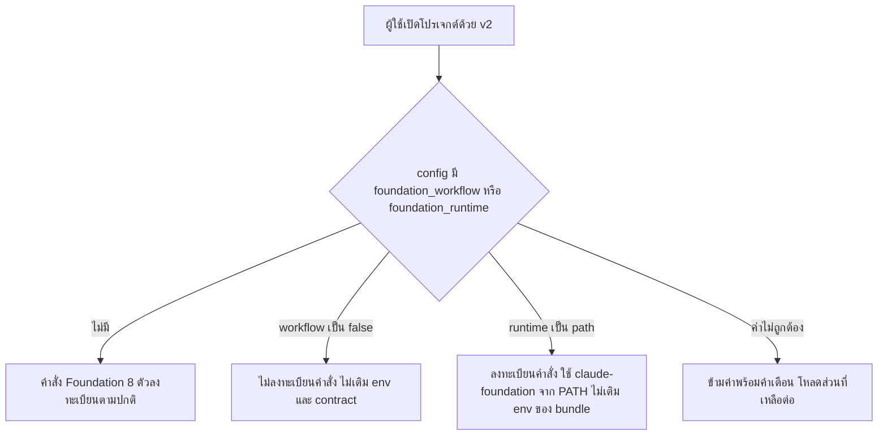

# Design

## Work type

feature

## เส้นทางผู้ใช้

ผู้ใช้ v1 เดิมที่ปิดหรือเปลี่ยน runtime ของ Foundation ใน config อัปเกรดเป็น v2 แล้วพฤติกรรมไม่เปลี่ยนโดยไม่ต้องแก้ config



## ตารางความล้มเหลว

| Failure | User sees | Recovery |
|---|---|---|
| foundation_workflow หรือ foundation_runtime มีค่าไม่ถูกต้อง เช่น "no" หรือ "system" | ไม่ล้ม ค่านั้นถูกข้ามพร้อม diagnostic ใน log และ workflow ทำงานตามค่าเริ่มต้น | แก้ค่าเป็น boolean หรือ bundled\|path |
| global ตั้ง foundation_workflow เป็น false แต่โปรเจกต์ตั้งเป็น true | โปรเจกต์นั้นได้คำสั่ง 8 ตัวกลับมา เหมือน v1 ที่ project ชนะ global | ตั้ง false ในโปรเจกต์เพื่อปิด |
| ผู้ใช้ตั้ง foundation_runtime ในโปรเจกต์หลัง global ปิด workflow | plugin เปิดกลับ เพราะ operation เพิ่มใน v2 เปิด plugin ที่ถูกปิดด้วย operation ลบก่อนหน้า (ต่างจาก v1 ที่ยังปิด) | ตั้ง foundation_workflow: false ในโปรเจกต์ด้วย |
| ฐานข้อมูล v1 มี session ที่มีคำสั่ง Foundation หรือ tool call ของ harness | migration ย้ายเป็นข้อความและ tool call ปกติ ไม่มีแถวที่ถูกข้ามเพราะเป็นข้อมูล Foundation | ไม่ต้องทำอะไร |

## แผนที่ไฟล์

| Tasks | Paths |
|---|---|
| T001 | `packages/core/src/config/normalize.ts`, `packages/core/src/plugin/supervisor.ts`, `packages/core/test/config/foundation-compat.test.ts` (add) |
| T002 | `packages/core/test/plugin/foundation-config.test.ts` (add) |
| T003 | `packages/cli/test/service-command.test.ts` (add) |
| T004 | `packages/core/test/v1-migration-foundation.test.ts` (add) |

`+` add · `~` change · `-` remove

```text
.
└── packages/
    ├── cli/
    │   └── test/
    │       └── + service-command.test.ts
    └── core/
        ├── src/
        │   ├── config/
        │   │   └── ~ normalize.ts
        │   └── plugin/
        │       └── ~ supervisor.ts
        └── test/
            ├── config/
            │   └── + foundation-compat.test.ts
            ├── plugin/
            │   └── + foundation-config.test.ts
            └── + v1-migration-foundation.test.ts
```

## แผนที่ test

| Scenario | Level | Check | Task |
|---|---|---|---|
| แปลง workflow; แปลง runtime; ค่าไม่ถูกต้อง; ไม่มี key | task check | `o=$(bun test --cwd packages/core test/config/foundation-compat.test.ts 2>&1); r=$?; echo "$o"; p=$(echo "$o" \| sed -n 's/^ *\([0-9]*\) pass$/\1/p'); f=$(echo "$o" \| sed -n 's/^ *\([0-9]*\) fail$/\1/p'); echo "Tests: ${f:-0} failed, ${p:-0} passed, $((${p:-0}+${f:-0})) total"; exit $r` | T001 |
| ปิดในโปรเจกต์; ปิดใน global; โปรเจกต์เปิดทับ global; ไม่มี key; ค่าไม่ถูกต้อง; runtime path; runtime bundled; เปลี่ยนค่าแล้ว activate ใหม่ | task check | `o=$(XDG_CACHE_HOME=$(mktemp -d) bun test --cwd packages/core test/plugin/foundation-config.test.ts 2>&1); r=$?; echo "$o"; p=$(echo "$o" \| sed -n 's/^ *\([0-9]*\) pass$/\1/p'); f=$(echo "$o" \| sed -n 's/^ *\([0-9]*\) fail$/\1/p'); echo "Tests: ${f:-0} failed, ${p:-0} passed, $((${p:-0}+${f:-0})) total"; exit $r` | T002 |
| command ของ CLI | task check | `o=$(bun test --cwd packages/cli test/service-command.test.ts 2>&1); r=$?; echo "$o"; p=$(echo "$o" \| sed -n 's/^ *\([0-9]*\) pass$/\1/p'); f=$(echo "$o" \| sed -n 's/^ *\([0-9]*\) fail$/\1/p'); echo "Tests: ${f:-0} failed, ${p:-0} passed, $((${p:-0}+${f:-0})) total"; exit $r` | T003 |
| session ที่มีคำสั่ง Foundation | task check | `o=$(bun test --cwd packages/core test/v1-migration-foundation.test.ts 2>&1); r=$?; echo "$o"; p=$(echo "$o" \| sed -n 's/^ *\([0-9]*\) pass$/\1/p'); f=$(echo "$o" \| sed -n 's/^ *\([0-9]*\) fail$/\1/p'); echo "Tests: ${f:-0} failed, ${p:-0} passed, $((${p:-0}+${f:-0})) total"; exit $r` | T004 |
