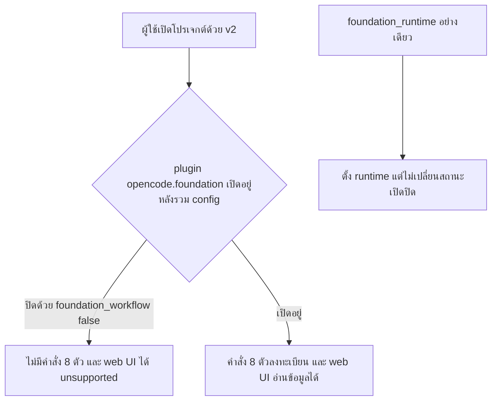

# Design

## Work type

feature

## เส้นทางผู้ใช้

ผู้ใช้ v1 ที่ปิดหรือกำหนด runtime ของ Foundation ใน config ได้พฤติกรรมเดิมทั้งใน CLI และ web UI



## ตารางความล้มเหลว

| Failure | User sees | Recovery |
|---|---|---|
| global ปิด foundation_workflow แล้วโปรเจกต์ตั้งแค่ foundation_runtime | workflow ยังปิดอยู่ ไม่มีคำสั่ง 8 ตัว | ตั้ง foundation_workflow: true ในโปรเจกต์ถ้าต้องการเปิด |
| web UI ขอข้อมูล Foundation ของโปรเจกต์ที่ปิด workflow | ตอบ unsupported ด้วยรหัส error เดิม ไม่เห็นข้อมูลโปรเจกต์ | ลบ foundation_workflow: false หรือตั้งเป็น true |
| foundation_workflow/foundation_runtime มีค่าไม่ถูกต้อง | ไม่ล้ม ค่านั้นถูกข้ามพร้อม diagnostic และใช้ค่าเริ่มต้น | แก้ค่าเป็น boolean หรือ bundled\|path |

## แผนที่ไฟล์

| Tasks | Paths |
|---|---|
| T001 | `packages/core/src/config/plugin/configure-only.ts` (add), `packages/core/src/config/normalize.ts`, `packages/core/src/plugin/supervisor.ts`, `packages/core/test/config/foundation-compat.test.ts` |
| T002 | `packages/core/test/plugin/foundation-config.test.ts` |
| T003 | `packages/server/src/handlers/foundation.ts`, `packages/server/test/foundation.test.ts` |

`+` add · `~` change · `-` remove

```text
.
└── packages/
    ├── core/
    │   ├── src/
    │   │   ├── config/
    │   │   │   ├── ~ normalize.ts
    │   │   │   └── plugin/
    │   │   │       └── + configure-only.ts
    │   │   └── plugin/
    │   │       └── ~ supervisor.ts
    │   └── test/
    │       ├── config/
    │       │   └── ~ foundation-compat.test.ts
    │       └── plugin/
    │           └── ~ foundation-config.test.ts
    └── server/
        ├── src/
        │   └── handlers/
        │       └── ~ foundation.ts
        └── test/
            └── ~ foundation.test.ts
```

## แผนที่ test

| Scenario | Level | Check | Task |
|---|---|---|---|
| แปลง runtime; ค่าไม่ถูกต้องในอินสแตนซ์จริง | task check | `o=$(bun test --cwd packages/core test/config/foundation-compat.test.ts 2>&1); r=$?; echo "$o"; p=$(echo "$o" \| sed -n 's/^ *\([0-9]*\) pass$/\1/p'); f=$(echo "$o" \| sed -n 's/^ *\([0-9]*\) fail$/\1/p'); echo "Tests: ${f:-0} failed, ${p:-0} passed, $((${p:-0}+${f:-0})) total"; exit $r` | T001 |
| global ปิด และโปรเจกต์มี runtime เท่านั้น; global ปิด และโปรเจกต์เปิดชัด; ไม่มี key; โปรเจกต์ปิดเอง; runtime พร้อม workflow true; option สงวนไม่รั่วเข้า plugin; options ใน plugins ชนะ runtime; ลบใน plugins ชนะ workflow true | task check | `o=$(XDG_CACHE_HOME=$(mktemp -d) bun test --cwd packages/core test/plugin/foundation-config.test.ts 2>&1); r=$?; echo "$o"; p=$(echo "$o" \| sed -n 's/^ *\([0-9]*\) pass$/\1/p'); f=$(echo "$o" \| sed -n 's/^ *\([0-9]*\) fail$/\1/p'); echo "Tests: ${f:-0} failed, ${p:-0} passed, $((${p:-0}+${f:-0})) total"; exit $r` | T002 |
| ปิดด้วย config; เปิดอยู่; คนละ location | task check | `o=$(bun test --cwd packages/server test/foundation.test.ts 2>&1); r=$?; echo "$o"; p=$(echo "$o" \| sed -n 's/^ *\([0-9]*\) pass$/\1/p'); f=$(echo "$o" \| sed -n 's/^ *\([0-9]*\) fail$/\1/p'); echo "Tests: ${f:-0} failed, ${p:-0} passed, $((${p:-0}+${f:-0})) total"; exit $r` | T003 |
