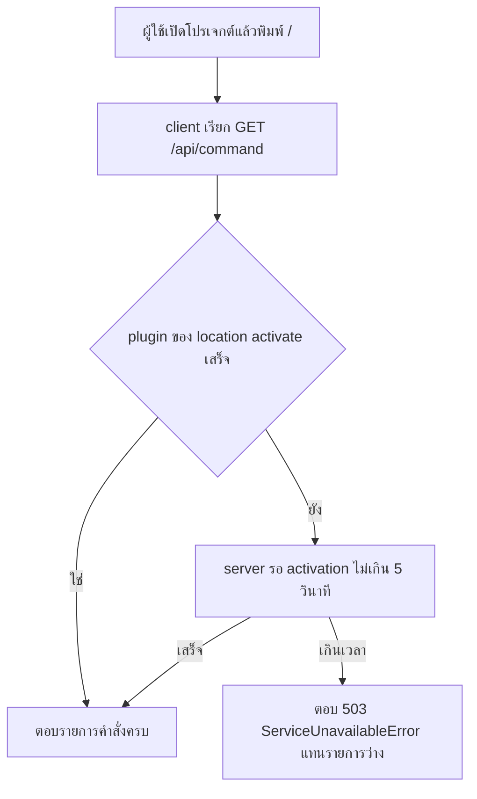

# Design

## Work type

bugfix

## เส้นทางผู้ใช้

ผู้ใช้ที่เพิ่งเปิดแอปหรือเปิดโปรเจกต์ใหม่พิมพ์ / แล้วเห็นรายการคำสั่งครบทันที



## Bugfix analysis

| ส่วน | รายละเอียด |
|---|---|
| วิธีทำให้เกิดซ้ำ | เริ่ม server จริงด้วย config ที่มีคำสั่งและ Foundation plugin builtin แล้วเรียก GET /api/command เป็นคำขอแรกของ location ผลก่อนแก้: data เป็น [] (0 รายการ) แล้วครบ 10 รายการในคำขอถัดไปราว 1-6 วินาทีต่อมา; test packages/server/test/command.test.ts ล้มก่อนแก้ด้วย names ว่าง |
| สาเหตุที่แท้จริง | handler command.list ใน packages/server/src/handlers/command.ts อ่าน Command.Service ทันทีโดยไม่เรียก awaitPlugins ขณะที่คำสั่งทุกตัวเพิ่มผ่าน command.transform ของ plugin ซึ่ง PluginSupervisor activate เป็น fiber เบื้องหลังต่อ location (agent/model/provider handler เรียก awaitPlugins อยู่แล้ว) |
| หลักฐาน regression | test packages/server/test/command.test.ts เริ่ม server จริง เรียก /api/command เป็นคำขอแรก และตรวจว่ามีคำสั่งจาก config กับ Foundation ครบ 8 ตัว |

## ตารางความล้มเหลว

| Failure | User sees | Recovery |
|---|---|---|
| plugin activation ไม่เสร็จภายใน 5 วินาที | คำขอได้ 503 ServiceUnavailableError พร้อมข้อความ Location plugins did not finish activating แทนรายการว่าง | client เรียกซ้ำเมื่อ activation เสร็จ |
| plugin ตัวหนึ่ง setup ล้ม | activation ยังเสร็จ (ตัวที่ล้มถูกปิด) รายการคำสั่งที่เหลือยังครบ | ไม่ต้องทำอะไร |

## แผนที่ไฟล์

| Tasks | Paths |
|---|---|
| T001 | `packages/server/src/handlers/command.ts`, `packages/protocol/src/groups/command.ts`, `packages/protocol/openapi.json`, `packages/server/test/command.test.ts` (add) |

`+` add · `~` change · `-` remove

```text
.
└── packages/
    ├── protocol/
    │   ├── ~ openapi.json
    │   └── src/
    │       └── groups/
    │           └── ~ command.ts
    └── server/
        ├── src/
        │   └── handlers/
        │       └── ~ command.ts
        └── test/
            └── + command.test.ts
```

## แผนที่ test

| Scenario | Level | Check | Task |
|---|---|---|---|
| คำขอแรกของ location ใหม่; activation ไม่เสร็จ; openapi ประกาศ 503 | task check | `o=$(bun test --cwd packages/server --timeout 60000 test/command.test.ts 2>&1); r=$?; echo "$o"; p=$(echo "$o" \| sed -n 's/^ *\([0-9]*\) pass$/\1/p'); f=$(echo "$o" \| sed -n 's/^ *\([0-9]*\) fail$/\1/p'); echo "Tests: ${f:-0} failed, ${p:-0} passed, $((${p:-0}+${f:-0})) total"; exit $r` | T001 |
