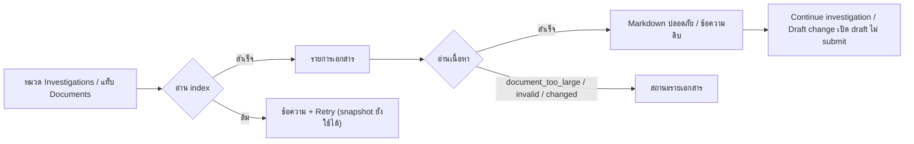

# Design

## Work type

ui

## เส้นทางผู้ใช้

ผู้ใช้เลือกโน้ตหรือ change แล้วอ่านเอกสารจริง รวมถึงเส้นทางที่เอกสารหาย ใหญ่เกิน เสีย หรือ server ไม่รองรับ



## โมเดลโดเมนและโมดูล

| Component | Responsibility | Files | Tasks |
|---|---|---|---|
| Document reader | เรียก foundation.documents/document/investigations/investigation, decode ด้วย schema และแปลง error | packages/app/src/changes/document-reader.ts | T002 |
| Document refresh | index + body ต่อ selection, cache ตาม modifiedAt/size, ทิ้ง response เก่า, poll 10 วินาที | packages/app/src/changes/document-refresh.ts | T002 |
| Excerpt | เลือกส่วนของโน้ตและส่วน Why | packages/app/src/changes/document-excerpt.ts | T002 |
| Safe Markdown | แปลง Markdown เป็น HTML ที่กรองแล้ว | packages/app/src/changes/markdown.ts, packages/app/src/changes/markdown.tsx, packages/app/src/changes/markdown.css | T002, T003 |
| Document workspace | หน้าอ่านโน้ต, Documents, Tasks, Evidence claims, Overview Why และ Data sources | packages/app/src/changes/workspace.tsx | T003 |
| Changes view และ route | หมวด Investigations พร้อม count, แท็บใหม่, ชื่อจาก proposal, navigation reference และ draft จากโน้ต | packages/app/src/changes/view.tsx, packages/app/src/changes/view-model.ts, packages/app/src/changes/route.tsx, packages/app/src/changes/draft.ts | T003, T004 |

## สัญญา UI

### Investigations

| State | Shows | Actions |
|---|---|---|
| loading | Loading documents… | — |
| empty | No saved investigations / No saved notes match your search | — |
| error | Document read unavailable (code) พร้อม Retry document read | — |
| list | แถวโน้ต: หัวข้อ, sourcePath, Note saved, เวลาแก้ไข | — |
| reader | หน้าอ่านโน้ตแยก: section nav, เนื้อหา, Full source text, references, Continue investigation, Draft change | — |

- **Accessibility:** รายการเป็น ul มี aria-label, section nav ใช้ aria-current location, ปุ่มสลับ raw ใช้ aria-pressed

### Change documents

| State | Shows | Actions |
|---|---|---|
| overview | Why จาก proposal.md, ข้อเท็จจริงจาก snapshot, ทางลัดไปเอกสาร, ชื่อจาก proposal H1 | — |
| documents | รายการ source documents ข้างเนื้อหาและแบ่งหน้า | — |
| tasks | n/m checked · Checklist only, not proof และรายการ task | — |
| evidence | Declared claims จาก evidence.yaml ไม่ใช่ผลทดสอบ | — |
| document-error | ข้อความต่อเอกสาร พร้อมข้อมูล runtime ที่ยังแสดงอยู่ | — |

- **Accessibility:** nav Source documents, ปุ่มทางลัดมีชื่อไฟล์, สถานะไม่พึ่งสี

## ตารางความล้มเหลว

| Failure | User sees | Recovery | Covers |
|---|---|---|---|
| เอกสารใหญ่หรือเสีย | ล้มด้วย code document_too_large และ invalid_document ตามลำดับ | No separate step; the outcome is the handling | document-reader |
| body ผิด schema | ล้มด้วย code invalid_response | No separate step; the outcome is the handling | document-reader |
| ไม่พบเอกสาร | state มี bodyError document_not_found และไม่มี document | No separate step; the outcome is the handling | document-refresh |
| body ล้มแต่ index ใช้ได้ | state เก็บ page ไว้ ตั้ง bodyError เป็น invalid_document และไม่ตั้ง error ของ index | No separate step; the outcome is the handling | document-refresh |
| anchor ไม่ถูกต้อง | ใช้ส่วนเริ่มต้นแทน | No separate step; the outcome is the handling | document-excerpt |
| raw HTML | ผลลัพธ์ไม่มี element script หรือ img และข้อความถูก escape | No separate step; the outcome is the handling | safe-markdown |
| ลิงก์อันตราย | ไม่เป็น a href แต่แสดงป้าย link unavailable | No separate step; the outcome is the handling | safe-markdown |
| รูปภาพ | ไม่มี element img และแสดง alt พร้อมป้าย image omitted | No separate step; the outcome is the handling | safe-markdown |
| ว่างแยกกรณี | แสดง No saved notes match your search และ No saved investigations ตามลำดับ | No separate step; the outcome is the handling | investigations-library |
| นับหมวด | ป้ายหมวดนั้นแสดง — แทนตัวเลข ไม่แสดง 0 | No separate step; the outcome is the handling | investigations-library |
| tasks ไม่รู้จัก | แสดง No recognizable task checkboxes. Inspect the original source. | No separate step; the outcome is the handling | change-documents |
| เอกสารอ่านไม่ได้ | Overview แสดง Proposal summary unavailable และข้อเท็จจริงจาก snapshot (phase, status, evidence) ยังแสดงอยู่ | No separate step; the outcome is the handling | change-documents |
| ข้อมูลที่ไม่มี | ข้อเท็จจริง Branch แสดง Unavailable ไม่เดาค่า | No separate step; the outcome is the handling | change-documents |

## แผนที่ไฟล์

| Tasks | Paths |
|---|---|
| T001 | `packages/app/package.json`, `bun.lock` |
| T002 | `packages/app/src/changes/document-reader.ts` (add), `packages/app/src/changes/document-reader.test.ts` (add), `packages/app/src/changes/document-refresh.ts` (add), `packages/app/src/changes/document-refresh.test.ts` (add), `packages/app/src/changes/document-excerpt.ts` (add), `packages/app/src/changes/document-excerpt.test.ts` (add), `packages/app/src/changes/markdown.ts` (add), `packages/app/src/changes/markdown.test.ts` (add) |
| T003 | `packages/app/src/changes/markdown.tsx` (add), `packages/app/src/changes/markdown.css` (add), `packages/app/src/changes/workspace.tsx` (add), `packages/app/src/changes/workspace.stories.tsx` (add), `packages/app/src/changes/view.tsx`, `packages/app/src/changes/view.stories.tsx`, `packages/app/src/changes/view-model.ts`, `packages/app/src/changes/view-model.test.ts`, `packages/app/src/changes/draft.ts`, `packages/app/src/changes/draft.test.ts`, `packages/app/component-tests/changes-documents.spec.ts` (add), `packages/app/src/runtime/i18n/en.ts` |
| T004 | `packages/app/src/changes/route.tsx` |

`+` add · `~` change · `-` remove

```text
.
├── ~ bun.lock
└── packages/
    └── app/
        ├── component-tests/
        │   └── + changes-documents.spec.ts
        ├── ~ package.json
        └── src/
            ├── changes/
            │   ├── + document-excerpt.test.ts
            │   ├── + document-excerpt.ts
            │   ├── + document-reader.test.ts
            │   ├── + document-reader.ts
            │   ├── + document-refresh.test.ts
            │   ├── + document-refresh.ts
            │   ├── ~ draft.test.ts
            │   ├── ~ draft.ts
            │   ├── + markdown.css
            │   ├── + markdown.test.ts
            │   ├── + markdown.ts
            │   ├── + markdown.tsx
            │   ├── ~ route.tsx
            │   ├── ~ view-model.test.ts
            │   ├── ~ view-model.ts
            │   ├── ~ view.stories.tsx
            │   ├── ~ view.tsx
            │   ├── + workspace.stories.tsx
            │   └── + workspace.tsx
            └── runtime/
                └── i18n/
                    └── ~ en.ts
```

## แผนที่ test

| Scenario | Level | Check | Task |
|---|---|---|---|
| lockfile ตรง | task check | `bun install --frozen-lockfile` | T001 |
| index ของ change; index ของโน้ต; เนื้อหาเอกสารและโน้ต; เอกสารใหญ่หรือเสีย; body ผิด schema; เลือก proposal; ใช้ cache; ไม่พบเอกสาร; body ล้มแต่ index ใช้ได้; ทิ้ง response เก่า; เปิดส่วน Findings; anchor ไม่ถูกต้อง; Why; โน้ตไม่มีหัวข้อ; raw HTML; ลิงก์อันตราย; ลิงก์ https; ลิงก์ไปเอกสารที่ index; รูปภาพ; anchor ของหัวข้อ | task check | `o=$(bun test --cwd packages/app --conditions=solid --isolate --preload ../ui/test/solid-jsx.ts --preload ./happydom.ts ./src/changes/document-reader.test.ts ./src/changes/document-refresh.test.ts ./src/changes/document-excerpt.test.ts ./src/changes/markdown.test.ts 2>&1); r=$?; echo "$o"; p=$(echo "$o" \| sed -n 's/^ *\([0-9]*\) pass$/\1/p'); f=$(echo "$o" \| sed -n 's/^ *\([0-9]*\) fail$/\1/p'); echo "Tests: ${f:-0} failed, ${p:-0} passed, $((${p:-0}+${f:-0})) total"; exit $r` | T002 |
| รายการโน้ต; ว่างแยกกรณี; ไม่มี reference; ตาม reference; draft จากโน้ต; นับหมวด; ชื่อจาก proposal; tasks เป็น checklist; tasks ไม่รู้จัก; claims ที่ประกาศ; เอกสารอ่านไม่ได้; ทางลัดเอกสาร; ข้อมูลที่ไม่มี | task check | `o=$(bun test --cwd packages/app --conditions=solid --isolate --preload ../ui/test/solid-jsx.ts --preload ./happydom.ts ./src/changes/view-model.test.ts ./src/changes/draft.test.ts 2>&1); r=$?; echo "$o"; p=$(echo "$o" \| sed -n 's/^ *\([0-9]*\) pass$/\1/p'); f=$(echo "$o" \| sed -n 's/^ *\([0-9]*\) fail$/\1/p'); echo "Tests: ${f:-0} failed, ${p:-0} passed, $((${p:-0}+${f:-0})) total"; exit $r` | T003 |
| รายการโน้ต; ว่างแยกกรณี; ไม่มี reference; ตาม reference; draft จากโน้ต; นับหมวด; ชื่อจาก proposal; tasks เป็น checklist; tasks ไม่รู้จัก; claims ที่ประกาศ; เอกสารอ่านไม่ได้; ทางลัดเอกสาร; ข้อมูลที่ไม่มี | task check | `bun run --cwd packages/app typecheck` | T004 |
