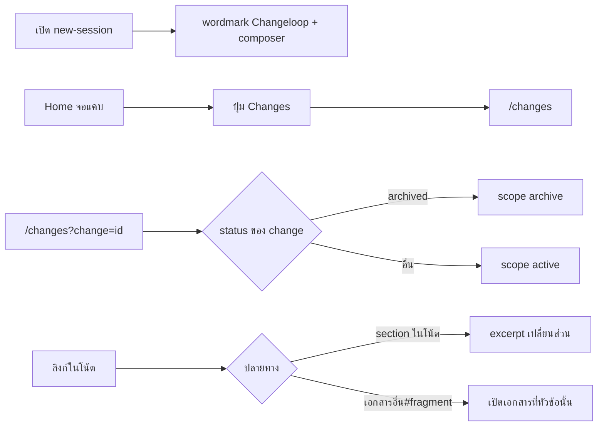

# Design

## Work type

ui

## เส้นทางผู้ใช้

ผู้ใช้เปิดหน้าเริ่ม session เห็นแบรนด์, เข้า Changes จากจอแคบ, เปิดลิงก์ change และอ่านโน้ตตามลิงก์ในเอกสาร



## โมเดลโดเมนและโมดูล

| Component | Responsibility | Files | Tasks |
|---|---|---|---|
| Brand | ตารางพิกเซลและ SVG ของ ChangeloopWordmark/Mark | packages/app/src/new-session/brand.ts, packages/app/src/new-session/brand.tsx, packages/app/src/new-session/brand.stories.tsx, packages/app/src/new-session/view.tsx | T001 |
| Note links | แปลงลิงก์ section/fragment และเปิดเอกสารที่ id ไม่อยู่ในหน้า index | packages/app/src/changes/markdown.ts, packages/app/src/changes/markdown-view.tsx, packages/app/src/changes/document-refresh.ts, packages/app/src/changes/workspace.tsx | T002, T004 |
| Navigation | default category ของ /changes และปุ่ม Changes บนจอแคบ | packages/app/src/changes/route.tsx, packages/app/src/changes/view-model.ts, packages/app/src/home/route.tsx, packages/app/src/home/projects/view.tsx | T003 |

## สัญญา UI

### New session

| State | Shows | Actions |
|---|---|---|
| default | wordmark Changeloop ชื่อ accessible Changeloop, composer ห่าง 32px, เนื้อหากว้างไม่เกิน 880px และ wordmark ไม่เกิน 720px | — |
| narrow | wordmark ย่อตามความกว้างโดยคงสัดส่วน 310:25 และไม่ดัน composer ลงเกินสัดส่วน | — |

- **Accessibility:** wordmark เป็น role img ชื่อ Changeloop; เส้นอ้อมของ O เป็นส่วนของภาพ

### Home narrow

| State | Shows | Actions |
|---|---|---|
| entry | ปุ่ม Changes ใต้ dropdown โปรเจกต์เมื่อจอแคบกว่า 768px | — |

- **Accessibility:** ปุ่มมีป้ายข้อความ Changes และเข้าถึงด้วยคีย์บอร์ด

### Note reader

| State | Shows | Actions |
|---|---|---|
| section-link | คลิกลิงก์ #slug ไปส่วนอื่นของโน้ตแล้ว excerpt เปลี่ยนส่วน | — |
| document-fragment | ลิงก์ design.md#why เปิด design.md ที่หัวข้อ Why | — |

- **Accessibility:** ลิงก์ภายในเป็น a ที่ focus ได้

## ตารางความล้มเหลว

| Failure | User sees | Recovery | Covers |
|---|---|---|---|
| slug ที่ไม่มี | ไม่เป็นลิงก์และแสดงป้าย link unavailable | No separate step; the outcome is the handling | note-links |
| id ที่ไม่มีจริง | state มี bodyError document_not_found และ index ยังใช้ได้ | No separate step; the outcome is the handling | note-links |

## แผนที่ไฟล์

| Tasks | Paths |
|---|---|
| T001 | `packages/app/src/new-session/brand.ts` (add), `packages/app/src/new-session/brand.test.ts` (add), `packages/app/src/new-session/brand.tsx` (add), `packages/app/src/new-session/brand.stories.tsx` (add), `packages/app/src/new-session/view.tsx`, `packages/app/component-tests/new-session-brand.spec.ts` (add) |
| T002 | `packages/app/src/changes/markdown.ts`, `packages/app/src/changes/markdown.test.ts`, `packages/app/src/changes/markdown-view.tsx`, `packages/app/src/changes/document-refresh.ts`, `packages/app/src/changes/document-refresh.test.ts`, `packages/app/src/changes/workspace.stories.tsx`, `packages/app/component-tests/changes-documents.spec.ts` |
| T002; T004 | `packages/app/src/changes/workspace.tsx` |
| T003 | `packages/app/src/changes/route.tsx`, `packages/app/src/changes/view-model.ts`, `packages/app/src/changes/view-model.test.ts`, `packages/app/src/home/route.tsx`, `packages/app/src/home/projects/view.tsx` |
| T004 | `packages/app/component-tests/changes-fidelity.spec.ts` (add), `packages/app/src/changes/view.tsx`, `packages/app/src/changes/view.stories.tsx` |

`+` add · `~` change · `-` remove

```text
.
└── packages/
    └── app/
        ├── component-tests/
        │   ├── ~ changes-documents.spec.ts
        │   ├── + changes-fidelity.spec.ts
        │   └── + new-session-brand.spec.ts
        └── src/
            ├── changes/
            │   ├── ~ document-refresh.test.ts
            │   ├── ~ document-refresh.ts
            │   ├── ~ markdown-view.tsx
            │   ├── ~ markdown.test.ts
            │   ├── ~ markdown.ts
            │   ├── ~ route.tsx
            │   ├── ~ view-model.test.ts
            │   ├── ~ view-model.ts
            │   ├── ~ view.stories.tsx
            │   ├── ~ view.tsx
            │   ├── ~ workspace.stories.tsx
            │   └── ~ workspace.tsx
            ├── home/
            │   ├── projects/
            │   │   └── ~ view.tsx
            │   └── ~ route.tsx
            └── new-session/
                ├── + brand.stories.tsx
                ├── + brand.test.ts
                ├── + brand.ts
                ├── + brand.tsx
                └── ~ view.tsx
```

## แผนที่ test

| Scenario | Level | Check | Task |
|---|---|---|---|
| ตาราง glyph; น้ำหนัก CHANGE และ LOOP; ช่องคั่นระหว่างสองคำ; ชื่อและสัดส่วนบนหน้า; จอแคบ | task check | `o=$(bun test --cwd packages/app --conditions=solid --isolate --preload ../ui/test/solid-jsx.ts --preload ./happydom.ts ./src/new-session/brand.test.ts 2>&1); r=$?; echo "$o"; p=$(echo "$o" \| sed -n 's/^ *\([0-9]*\) pass$/\1/p'); f=$(echo "$o" \| sed -n 's/^ *\([0-9]*\) fail$/\1/p'); echo "Tests: ${f:-0} failed, ${p:-0} passed, $((${p:-0}+${f:-0})) total"; exit $r` | T001 |
| slug ไปส่วนอื่นของโน้ต; slug ที่ไม่มี; id นอกหน้า index; id ที่ไม่มีจริง; fragment ของเอกสาร | task check | `o=$(bun test --cwd packages/app --conditions=solid --isolate --preload ../ui/test/solid-jsx.ts --preload ./happydom.ts ./src/changes/markdown.test.ts ./src/changes/document-refresh.test.ts 2>&1); r=$?; echo "$o"; p=$(echo "$o" \| sed -n 's/^ *\([0-9]*\) pass$/\1/p'); f=$(echo "$o" \| sed -n 's/^ *\([0-9]*\) fail$/\1/p'); echo "Tests: ${f:-0} failed, ${p:-0} passed, $((${p:-0}+${f:-0})) total"; exit $r` | T002 |
| archived; ยังไม่ทราบ status; ไม่มี change; scope ชัดเจนชนะ; ปุ่มบนจอแคบ; กลุ่ม utility เต็ม | task check | `o=$(bun test --cwd packages/app --conditions=solid --isolate --preload ../ui/test/solid-jsx.ts --preload ./happydom.ts ./src/changes/view-model.test.ts 2>&1); r=$?; echo "$o"; p=$(echo "$o" \| sed -n 's/^ *\([0-9]*\) pass$/\1/p'); f=$(echo "$o" \| sed -n 's/^ *\([0-9]*\) fail$/\1/p'); echo "Tests: ${f:-0} failed, ${p:-0} passed, $((${p:-0}+${f:-0})) total"; [ $r -eq 0 ] \|\| exit $r; bun run --cwd packages/app typecheck` | T003 |
| ส่วนหัวของรายการ; รายละเอียดไม่มีตัวควบคุมรายการ; ความกว้างเนื้อหา | task check | `bun run --cwd packages/app typecheck && bun run --cwd packages/app build` | T004 |
