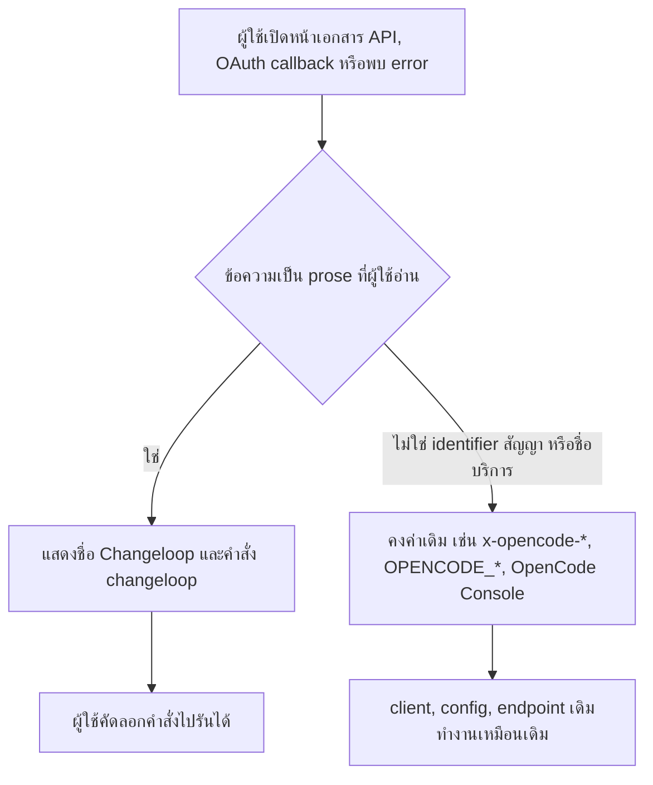

# Design

## Work type

feature

## เส้นทางผู้ใช้

ผู้ใช้ที่เปิดหน้า OAuth, ตอบคำถามขอสิทธิ์, อ่าน error หรือเปิดเอกสาร API เห็นชื่อ Changeloop และคัดลอกคำสั่งที่แนะนำไปรันได้จริง



## ตารางความล้มเหลว

| Failure | User sees | Recovery |
|---|---|---|
| มีข้อความใหม่ที่มีคำว่า OpenCode ใน prose ของ core/server/protocol | guard test ล้มพร้อมระบุไฟล์และบรรทัด | เปลี่ยนเป็น Changeloop หรือเพิ่มใน allowlist พร้อมเหตุผล |
| เผลอเปลี่ยน identifier สัญญา (header, id, env, URL) | test identifier ล้ม | คืนค่า identifier เดิม |
| client เดิมอ้างอิงข้อความ error ภาษาอังกฤษของ server | ไม่มีผล เพราะ client ใช้ code และ status ไม่ใช่ข้อความ | ไม่ต้องทำอะไร |

## แผนที่ไฟล์

| Tasks | Paths |
|---|---|
| T001 | `packages/core/src/oauth/page.ts`, `packages/core/src/tool/plugin/websearch.ts`, `packages/core/src/generate.ts`, `packages/core/test/oauth-page.test.ts`, `packages/core/test/tool-websearch.test.ts` |
| T002 | `packages/server/src/process.ts`, `packages/server/src/handlers/server.ts`, `packages/protocol/src/api.ts`, `packages/protocol/src/groups/persistent-pty.ts`, `packages/protocol/src/groups/session.ts`, `packages/server/test/openapi-brand.test.ts` (add) |
| T003 | `packages/core/test/brand-prose.test.ts` (add) |

`+` add · `~` change · `-` remove

```text
.
└── packages/
    ├── core/
    │   ├── src/
    │   │   ├── ~ generate.ts
    │   │   ├── oauth/
    │   │   │   └── ~ page.ts
    │   │   └── tool/
    │   │       └── plugin/
    │   │           └── ~ websearch.ts
    │   └── test/
    │       ├── + brand-prose.test.ts
    │       ├── ~ oauth-page.test.ts
    │       └── ~ tool-websearch.test.ts
    ├── protocol/
    │   └── src/
    │       ├── ~ api.ts
    │       └── groups/
    │           ├── ~ persistent-pty.ts
    │           └── ~ session.ts
    └── server/
        ├── src/
        │   ├── handlers/
        │   │   └── ~ server.ts
        │   └── ~ process.ts
        └── test/
            └── + openapi-brand.test.ts
```

## แผนที่ test

| Scenario | Level | Check | Task |
|---|---|---|---|
| หน้า OAuth callback; คำสั่งแนะนำ; คำถามขอสิทธิ์ค้นเว็บ; ชื่อบริการคงเดิม | task check | `o=$(bun test --cwd packages/core test/oauth-page.test.ts test/tool-websearch.test.ts 2>&1); r=$?; echo "$o"; p=$(echo "$o" \| sed -n 's/^ *\([0-9]*\) pass$/\1/p'); f=$(echo "$o" \| sed -n 's/^ *\([0-9]*\) fail$/\1/p'); echo "Tests: ${f:-0} failed, ${p:-0} passed, $((${p:-0}+${f:-0})) total"; exit $r` | T001 |
| info และ description; path และ header คงเดิม; หน้า OAuth callback; คำสั่งแนะนำ; คำถามขอสิทธิ์ค้นเว็บ; ชื่อบริการคงเดิม | task check | `o=$(bun test --cwd packages/server --timeout 60000 test/openapi-brand.test.ts 2>&1); r=$?; echo "$o"; p=$(echo "$o" \| sed -n 's/^ *\([0-9]*\) pass$/\1/p'); f=$(echo "$o" \| sed -n 's/^ *\([0-9]*\) fail$/\1/p'); echo "Tests: ${f:-0} failed, ${p:-0} passed, $((${p:-0}+${f:-0})) total"; exit $r` | T002 |
| guard ไม่พบ prose; identifier คงเดิม | task check | `o=$(bun test --cwd packages/core test/brand-prose.test.ts 2>&1); r=$?; echo "$o"; p=$(echo "$o" \| sed -n 's/^ *\([0-9]*\) pass$/\1/p'); f=$(echo "$o" \| sed -n 's/^ *\([0-9]*\) fail$/\1/p'); echo "Tests: ${f:-0} failed, ${p:-0} passed, $((${p:-0}+${f:-0})) total"; exit $r` | T003 |
