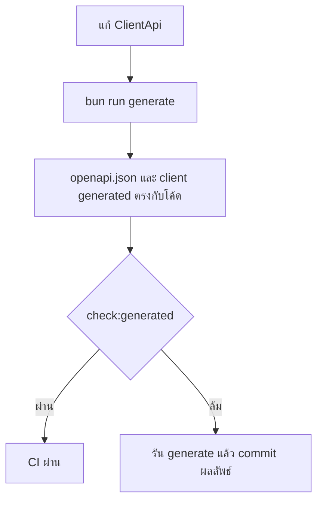

# Design

## Work type

api

## สถาปัตยกรรม

| ขอบเขต | รูปแบบ | เหตุผล | Timeout/การลองใหม่ | ความสอดคล้อง | เจ้าของ |
|---|---|---|---|---|---|
| packages/protocol ClientApi → openapi.json และ client generated | sync | generator อ่านนิยาม API ในโค้ดแล้วเขียน snapshot ตอน build | none (สคริปต์ในเครื่อง); ลองใหม่: none; รัน generate ซ้ำได้และให้ผลเดิม | strong | protocol |

## เส้นทางผู้ใช้

ผู้พัฒนาที่ใช้ openapi.json หรือ client generated เห็น endpoint ครบเท่ากับที่ server ให้บริการ และ check:generated ผ่านใน CI



## สัญญา API

### GET /experimental/foundation/capability

| ส่วน | สัญญา |
|---|---|
| การยืนยันสิทธิ์ | เหมือน route อื่นของ server (authorization middleware) |
| Request | location: directory ทางเลือก |
| Response | available: boolean, code: string\|null, runtime: {mode,version}\|null |

### GET /experimental/foundation/changes

| ส่วน | สัญญา |
|---|---|
| การยืนยันสิทธิ์ | เหมือน route อื่นของ server (authorization middleware) |
| Request | scope: active\|archive, search: string, offset: string, limit: string |
| Response | generatedAt: string, items: Change[], total: number, nextOffset: number\|null, diagnostics: string[] |

**Error:**

| Status | Code | เมื่อ | ลองใหม่ได้ |
|---|---|---|---|
| 400 | — | offset, limit, scope หรือ search ไม่ถูกต้อง | — |
| 409 | — | project ยังไม่ init Foundation (not_initialized) | — |
| 502 | — | snapshot เกิน 1 MiB หรือผิดรูป (output_too_large, invalid_response) | — |
| 503 | — | runtime ใช้ไม่ได้หรือ server ปิด Foundation (runtime_unavailable, unsupported) | — |
| 504 | — | runtime ไม่ตอบภายใน 5 วินาที (timeout) | — |

### GET /experimental/foundation/changes/:changeID

| ส่วน | สัญญา |
|---|---|
| การยืนยันสิทธิ์ | เหมือน route อื่นของ server (authorization middleware) |
| Request | changeID: string |
| Response | id: string, status: string, phase: string |

**Error:**

| Status | Code | เมื่อ | ลองใหม่ได้ |
|---|---|---|---|
| 400 | — | changeID ผิดรูปแบบ | — |
| 404 | — | ไม่พบ change | — |
| 409 | — | project ยังไม่ init Foundation | — |

### GET /experimental/foundation/changes/:changeID/documents

| ส่วน | สัญญา |
|---|---|
| การยืนยันสิทธิ์ | เหมือน route อื่นของ server (authorization middleware) |
| Request | changeID: string, search: string, offset: string, limit: string |
| Response | items: DocumentMetadata[], total: number, nextOffset: number\|null, readAt: string, diagnostics: string[] |

**Error:**

| Status | Code | เมื่อ | ลองใหม่ได้ |
|---|---|---|---|
| 400 | — | changeID หรือ query ไม่ถูกต้อง | — |
| 404 | — | ไม่พบเอกสารของ change | — |

### GET /experimental/foundation/changes/:changeID/documents/:documentID

| ส่วน | สัญญา |
|---|---|
| การยืนยันสิทธิ์ | เหมือน route อื่นของ server (authorization middleware) |
| Request | changeID: string, documentID: sha256 hex 64 ตัว |
| Response | id: string, text: string, sha256: string, sections: Section[], tasks: Task[], references: Reference[] |

**Error:**

| Status | Code | เมื่อ | ลองใหม่ได้ |
|---|---|---|---|
| 400 | — | documentID ผิดรูปหรือเอกสารเป็น symlink | — |
| 404 | — | ไม่พบเอกสาร | — |
| 413 | — | เอกสารเกิน 256 KiB | — |

### GET /experimental/foundation/investigations

| ส่วน | สัญญา |
|---|---|
| การยืนยันสิทธิ์ | เหมือน route อื่นของ server (authorization middleware) |
| Request | search: string, offset: string, limit: string |
| Response | items: DocumentMetadata[], total: number, nextOffset: number\|null, readAt: string, diagnostics: string[] |

**Error:**

| Status | Code | เมื่อ | ลองใหม่ได้ |
|---|---|---|---|
| 400 | — | query ไม่ถูกต้อง | — |

### GET /experimental/foundation/investigations/:investigationID

| ส่วน | สัญญา |
|---|---|
| การยืนยันสิทธิ์ | เหมือน route อื่นของ server (authorization middleware) |
| Request | investigationID: sha256 hex 64 ตัว |
| Response | id: string, text: string, sha256: string, sections: Section[], references: Reference[] |

**Error:**

| Status | Code | เมื่อ | ลองใหม่ได้ |
|---|---|---|---|
| 400 | — | investigationID ผิดรูป | — |
| 404 | — | ไม่พบ investigation | — |

## ตารางความล้มเหลว

| Failure | User sees | Recovery |
|---|---|---|
| openapi.json ไม่ตรงกับ ClientApi | check:generated ล้มพร้อมข้อความให้รัน generate | รัน bun run generate ใน packages/protocol |
| client generated ไม่ตรงกับ openapi/ClientApi | typecheck หรือ test ของ client ล้ม | รัน bun run generate ใน packages/client |

## แผนที่ไฟล์

| Tasks | Paths |
|---|---|
| T001 | `packages/protocol/openapi.json` |
| T002 | `packages/client/src/promise/generated/client.ts` |

`+` add · `~` change · `-` remove

```text
.
└── packages/
    ├── client/
    │   └── src/
    │       └── promise/
    │           └── generated/
    │               └── ~ client.ts
    └── protocol/
        └── ~ openapi.json
```

## แผนที่ test

| Scenario | Level | Check | Task |
|---|---|---|---|
| check ผ่าน; foundation ครบ | task check | `bun --cwd packages/protocol run check:generated && o=$({ bun test --cwd packages/protocol test && bun test --cwd packages/server --timeout 60000 test/openapi-brand.test.ts test/command.test.ts test/foundation.test.ts; } 2>&1); r=$?; echo "$o"; p=$(echo "$o" \| awk '/^ *[0-9]+ pass$/{s+=$1}END{print s+0}'); f=$(echo "$o" \| awk '/^ *[0-9]+ fail$/{s+=$1}END{print s+0}'); echo "Tests: $f failed, $p passed, $((p+f)) total"; exit $r` | T001 |
| generated ตรงกัน; client ทำงาน | task check | `bun --cwd packages/protocol run check:generated && o=$({ bun test --cwd packages/client test/promise.test.ts test/effect.test.ts test/foundation.test.ts test/contract-identity.test.ts; } 2>&1); r=$?; echo "$o"; p=$(echo "$o" \| awk '/^ *[0-9]+ pass$/{s+=$1}END{print s+0}'); f=$(echo "$o" \| awk '/^ *[0-9]+ fail$/{s+=$1}END{print s+0}'); echo "Tests: $f failed, $p passed, $((p+f)) total"; exit $r` | T002 |
