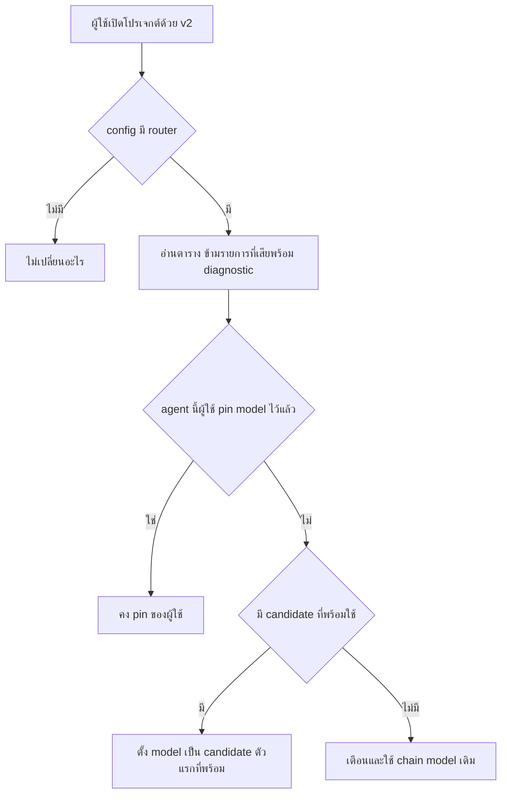

# Change: port model router ของ v1 ไป v2: config section router (tiers, agents, small_model) และ built-in plugin ที่ตั้ง model ของ agent กับช่อง small-model เป็น candidate ตัวแรกที่พร้อมใช้ พร้อมคำเตือนเมื่อ resolve ไม่ได้

- **Change:** `port-model-router-v1-v2-config-section-router-tiers-agents-small` · **Lane:** rapid (low risk)
- **Review:** not required · **Owner:** unassigned · **Created:** 2026-11-02

## เหตุผล

v1 ของ fork มี model router: config section `router` (`tiers`, `agents`, `small_model`) และ built-in plugin ที่ตอน boot ตั้ง model ของ agent ที่ถูก map (รวมช่อง small-model) เป็น candidate ตัวแรกที่ provider พร้อมใช้ พร้อมคำเตือนเมื่อไม่มี candidate ใช้ได้ บน v2 ไม่มีโค้ดนี้ และ normalize ของ v2 ทิ้ง key `router` เงียบๆ ผู้ใช้ที่ตั้ง `router` จึงไม่ได้ routing โดยไม่มี error

## ขอบเขต

ทำ:

- `ConfigNormalize` อ่าน `router` (ตรวจรูปแบบทีละรายการ ข้ามค่าเสียพร้อม diagnostic) แล้วแปลงเป็น plugin operation แบบ configure-only ของ builtin `opencode.router` ตามแบบเดียวกับ `foundation_runtime` จึงไม่เพิ่ม field ใน `Info` schema (ไม่กระทบ OpenAPI/SDK) และ config ที่ไม่มี `router` ไม่เปลี่ยน
- builtin plugin `opencode.router` (packages/core/src/plugin/router.ts) ลงทะเบียน agent transform ที่ใช้ `resolveRouting` (port จาก v1) ตั้ง `agent.model` ของ agent ที่ map ไว้เมื่อช่องว่าง และตั้ง model ของ agent `title` สำหรับ `small_model` (ช่อง small-model ของ v2 คือ agent `title`) ความพร้อมของ candidate อ่านจาก `Model.available()` และ reload เมื่อมี event `model.updated`
- คำเตือนของ rule ที่ resolve ไม่ได้ถูก log ครั้งเดียวต่อข้อความ

ไม่ทำ: ชื่อไฟล์ config changeloop.json (ทีม G1), UI ตั้งค่า router, docs

- **In scope (`model-router`):** แปลง section router เป็น plugin operation แบบ configure-only ของ opencode.router โดยข้ามรายการผิดรูปพร้อม diagnostic ชนิด invalid และ config ที่ไม่มี router SHALL ไม่เปลี่ยน; ตั้ง model ของ agent และช่อง small-model เป็น candidate ตัวแรกที่ใช้ได้ของ tier (หรือ model ตรงๆ) เติมเฉพาะช่องที่ว่าง และเมื่อไม่มี candidate ใช้ได้ SHALL ไม่ pin และ SHALL คืนคำเตือนหนึ่งข้อความต่อช่อง; ตั้ง model ของ agent ที่ map ไว้และ agent title ตามความพร้อมของ provider, ไม่ทับ pin ของผู้ใช้, ไม่ pin เมื่อไม่มี candidate พร้อม และ SHALL ไม่เปลี่ยนอะไรเมื่อไม่มี router
- **Out of scope:** edits outside `packages/core/src/config/normalize.ts`, `packages/core/test/config/router-compat.test.ts`, `packages/core/src/plugin/router.ts`, `packages/core/src/plugin/internal.ts`, `packages/core/test/plugin/router.test.ts`, `packages/core/test/plugin/router-config.test.ts`

## User flow

ผู้ใช้ v1 ที่ตั้ง router ใน config อัปเกรดเป็น v2 แล้ว agent ได้ model ตามตารางโดยไม่ต้องแก้ config

## Work type

feature

## Failure matrix

| Failure | User sees | Recovery |
|---|---|---|
| ไม่มี candidate ของ tier ที่ map ไว้ที่พร้อมใช้ | คำเตือน changeloop-router ใน log agent นั้นใช้ model ตาม chain เดิม boot ไม่ล้ม | เพิ่ม credential ของ provider หรือเพิ่ม candidate อื่นใน tier |
| router มีรายการผิดรูป เช่น tier ที่ไม่ใช่อาร์เรย์ หรือ agents ที่ค่าไม่ใช่ string | diagnostic ชนิด invalid ที่ path ของรายการนั้น รายการอื่นใน router และ config ส่วนที่เหลือยังใช้งาน | แก้รายการที่ระบุใน diagnostic |
| ตารางอ้างถึง agent ที่ไม่มีอยู่ | คำเตือน agent ไม่พบ ไม่มี agent ใหม่ถูกสร้าง | แก้ชื่อ agent หรือสร้าง agent นั้น |
| ผู้ใช้ pin model ของ agent หรือ small model ไว้เองและตาราง router map agent เดียวกัน | pin ของผู้ใช้ชนะ router ไม่เปลี่ยน | ไม่ต้องทำอะไร |
| ผู้ใช้ตั้ง router ทั้งใน global และโปรเจกต์ | ใช้ตาราง router ทั้งก้อนจากเอกสารที่ลำดับสูงสุด (โปรเจกต์) ไม่ merge กับ global เหมือน v1 | ย้ายรายการทั้งหมดไปไว้ในไฟล์เดียวกัน |

## ผลกระทบและความเสี่ยง

- **Impact:** low
- **Coupling:** isolated

## การสื่อสาร การดูแลหลังปล่อย และ release note

### Release note

ผู้ใช้ Changeloop v1 ที่ตั้ง router (tiers, agents, small_model) ใน config ได้ routing กลับมาบนเวอร์ชันใหม่: agent ที่ map ไว้ได้ model ตัวแรกที่ provider พร้อมใช้ เว้นแต่ pin เองไว้ และ small_model ตั้งโมเดลสำหรับตั้งชื่อ session ถ้าไม่มี candidate พร้อมจะมีคำเตือนและใช้ model เดิม config ที่ไม่มี router ไม่เปลี่ยน

## เกณฑ์ผ่าน

Task: `tasks.md`; scenario: ใน specs

| Requirement | Scenario | ชนิด | Task | Check | Decision |
|---|---|---|---|---|---|
| router-config-normalize | รายการผิดรูปถูกข้าม | failure | T001 | test: `packages/core/test/config/router-compat.test.ts` | — |
|  | router ไม่ใช่ object | failure | T001 |  |  |
|  | แปลงตารางที่ถูกต้อง | unclassified | T001 |  |  |
|  | ไม่มี router | unclassified | T001 |  |  |
| router-resolution | pin candidate แรกที่พร้อม | unclassified | T002 | test: `packages/core/test/plugin/router.test.ts` | — |
|  | ข้ามไป candidate ถัดไป | unclassified | T002 |  |  |
|  | ไม่มี candidate พร้อม | unclassified | T002 |  |  |
|  | pin ของผู้ใช้ชนะ | unclassified | T002 |  |  |
|  | ชื่อ tier ไม่มี candidate | unclassified | T002 |  |  |
| router-instance | provider พร้อม | unclassified | T003 | test: `packages/core/test/plugin/router-config.test.ts` | — |
|  | provider ไม่พร้อม | unclassified | T003 |  |  |
|  | pin ของผู้ใช้ชนะ | unclassified | T003 |  |  |
|  | ไม่มี router | unclassified | T003 |  |  |
|  | ค่าผิดรูป | unclassified | T003 |  |  |
|  | ปิด plugin | unclassified | T003 |  |  |

## นิยามของงานเสร็จ

- Fresh evidence for every claim (15).
- Changed tests fail on the original code.
- Review: not required (rapid lane, low tier: deterministic evidence only).
- Land archives it; Land never commits.
- Success: acceptance scenarios above pass.
