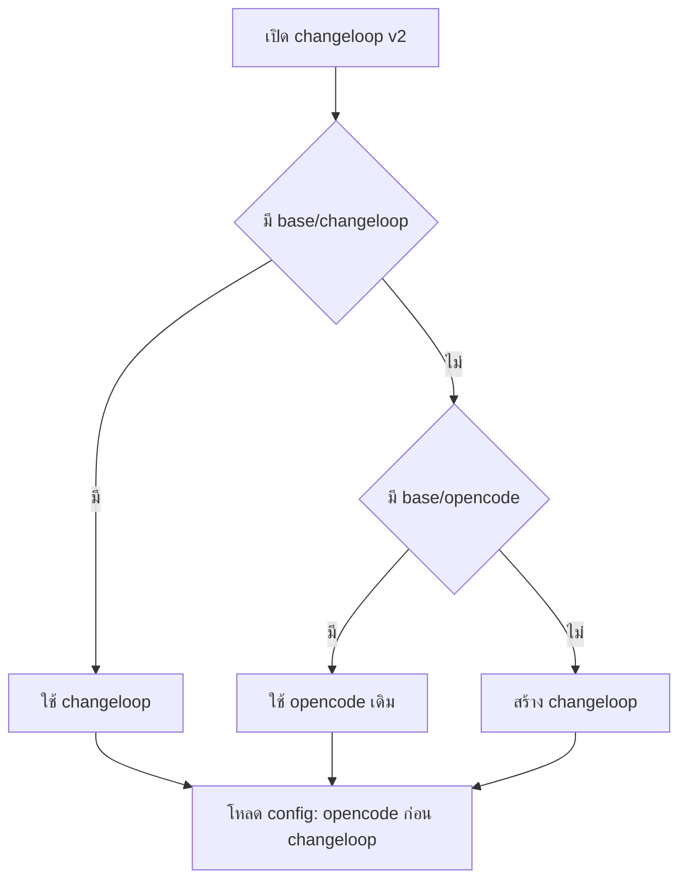

# Design

## Work type

feature

## เส้นทางผู้ใช้

ผู้ใช้ Changeloop v1 ตั้งค่าด้วยชื่อ changeloop บน v2 ได้เหมือนเดิม และผู้ใช้ opencode เดิมไม่ถูกกระทบ



## ตารางความล้มเหลว

| Failure | User sees | Recovery |
|---|---|---|
| มีทั้ง dir changeloop และ opencode ใน base เดียวกัน | ใช้ dir changeloop (ข้อมูลใน opencode ไม่ถูกอ่านใน base นั้น) | คัดลอกข้อมูลจาก dir opencode ไป changeloop หรือลบ dir changeloop |
| changeloop.json เป็น JSON ไม่ถูกต้อง | ได้ diagnostic ของไฟล์นั้นแบบเดียวกับ opencode.json และไฟล์อื่นยังโหลด | แก้ไฟล์ตาม diagnostic |
| ตั้งทั้ง CHANGELOOP_X และ OPENCODE_X | ใช้ค่าของ CHANGELOOP_X | ลบตัวแปรที่ไม่ต้องการ |

## แผนที่ไฟล์

| Tasks | Paths |
|---|---|
| T001 | `packages/util/src/env-alias.ts` (add), `packages/util/src/global.ts`, `packages/util/test/env-alias.test.ts` (add), `packages/util/test/global.test.ts` |
| T002 | `packages/core/src/config/discovery.ts`, `packages/core/src/config.ts`, `packages/core/test/config/config.test.ts`, `packages/core/test/config/changeloop-names.test.ts` (add) |
| T003 | `packages/core/src/plugin/plan.ts`, `packages/core/test/plugin/plan.test.ts` |
| T004 | `packages/cli/src/index.ts`, `packages/cli/test/debug-paths.test.ts` |

`+` add · `~` change · `-` remove

```text
.
└── packages/
    ├── cli/
    │   ├── src/
    │   │   └── ~ index.ts
    │   └── test/
    │       └── ~ debug-paths.test.ts
    ├── core/
    │   ├── src/
    │   │   ├── ~ config.ts
    │   │   ├── config/
    │   │   │   └── ~ discovery.ts
    │   │   └── plugin/
    │   │       └── ~ plan.ts
    │   └── test/
    │       ├── config/
    │       │   ├── + changeloop-names.test.ts
    │       │   └── ~ config.test.ts
    │       └── plugin/
    │           └── ~ plan.test.ts
    └── util/
        ├── src/
        │   ├── + env-alias.ts
        │   └── ~ global.ts
        └── test/
            ├── + env-alias.test.ts
            └── ~ global.test.ts
```

## แผนที่ test

| Scenario | Level | Check | Task |
|---|---|---|---|
| ติดตั้งใหม่; ผู้ใช้ opencode เดิม; มีทั้งสอง; ตัดสินแยกต่อ base; ลำดับ test home; เห็นผ่าน debug paths จริง; alias ชนะ; fallback; ตัวแปรอื่นไม่ถูกแตะ | task check | `o=$(bun test --cwd packages/util test/global.test.ts test/global-roots.test.ts test/env-alias.test.ts 2>&1); r=$?; echo "$o"; p=$(echo "$o" \| sed -n 's/^ *\([0-9]*\) pass$/\1/p'); f=$(echo "$o" \| sed -n 's/^ *\([0-9]*\) fail$/\1/p'); echo "Tests: ${f:-0} failed, ${p:-0} passed, $((${p:-0}+${f:-0})) total"; exit $r` | T001 |
| global changeloop ชนะ opencode; jsonc ชนะ json; โปรเจกต์; เฉพาะ opencode เหมือนเดิม; update เลือกไฟล์ที่ชนะ; update seed; ไฟล์เสีย; ลำดับ directory; เฉพาะ .changeloop; ซ้อนหลายระดับ; command ใน .changeloop ใช้ได้จริง | task check | `o=$(bun test --cwd packages/core test/config/config.test.ts test/config/watch.test.ts 2>&1); r=$?; echo "$o"; p=$(echo "$o" \| sed -n 's/^ *\([0-9]*\) pass$/\1/p'); f=$(echo "$o" \| sed -n 's/^ *\([0-9]*\) fail$/\1/p'); echo "Tests: ${f:-0} failed, ${p:-0} passed, $((${p:-0}+${f:-0})) total"; exit $r` | T002 |
| อนุญาต changeloop plan; opencode plan เดิมยังได้; ที่อื่นถูกปฏิเสธ | task check | `o=$(bun test --cwd packages/core test/plugin/plan.test.ts 2>&1); r=$?; echo "$o"; p=$(echo "$o" \| sed -n 's/^ *\([0-9]*\) pass$/\1/p'); f=$(echo "$o" \| sed -n 's/^ *\([0-9]*\) fail$/\1/p'); echo "Tests: ${f:-0} failed, ${p:-0} passed, $((${p:-0}+${f:-0})) total"; exit $r` | T003 |
| ติดตั้งใหม่; ผู้ใช้ opencode เดิม; มีทั้งสอง; ตัดสินแยกต่อ base; ลำดับ test home; เห็นผ่าน debug paths จริง; alias ชนะ; fallback; ตัวแปรอื่นไม่ถูกแตะ | task check | `o=$(bun test --cwd packages/cli test/debug-paths.test.ts 2>&1); r=$?; echo "$o"; p=$(echo "$o" \| sed -n 's/^ *\([0-9]*\) pass$/\1/p'); f=$(echo "$o" \| sed -n 's/^ *\([0-9]*\) fail$/\1/p'); echo "Tests: ${f:-0} failed, ${p:-0} passed, $((${p:-0}+${f:-0})) total"; exit $r` | T004 |
